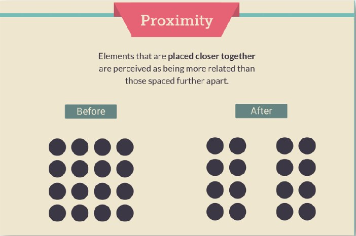

# 01 接近原则（Proximity）

## 定义

在其他条件相近时，空间距离较近的元素更容易被知觉为一组。

## 边界

颜色、边框等线索也会影响分组。与标记的距离近，并不保证读者会把标签归给该标记。

## 示例

都会区营收图把金额贴近对应地名。 [Fortune 500 都会区营收图](../../02-信息图形类型案例/01-混合型信息图形/Fortune500都会区营收案例.md)

## 设计分析

标记密集时，标签容易靠近两个地名。适当扩大组间留白可减少误配。

## 实践建议

保持字号、颜色和容器一致，只改变间距，比较读者的标签配对正确率。

## 课件图例与设计实践

*课件图例，PDF 第 34 页。*

第 34 页，§6.2.1「邻近原则 接近原则」。图例两侧都使用 16 个同样的深色圆点。左侧圆点均匀排列，右侧拉开中间两列的距离，使版面更容易读成两组。

**设计实践。** 在数字卡片中缩短指标名、数值与单位之间的距离，拉开相邻指标之间的距离。对照两版时固定颜色和字号，请读者把数值配给正确的指标。 [《交互信息设计_编辑版(1)》](../15-参考文献与术语对照/15-参考文献与术语对照.md#用户提供的课件)

## 参考

[Wagemans 等，2012，视觉组织综述](https://elderlab.yorku.ca/wp-content/uploads/2016/12/WagemansPsychBull12.pdf) · [Wertheimer，1923，知觉形式的组织规律（1938 英译）](https://psychclassics.yorku.ca/Wertheimer/Forms/forms.htm)

[返回目录](../README.md)
