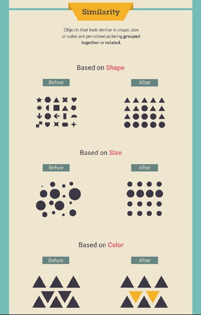

# 02 相似原则（Similarity）

## 定义

颜色、形状、大小或朝向相近的元素更容易被组织在一起。

## 边界

同色可能表示类别，也可能只是高亮。编码含义由图例和上下文决定。

## 示例

纽约的圆标与引线都用白色，其他标记用深色。 [Fortune 500 都会区营收图](../02-信息图形类型案例/01-混合型信息图形/Fortune500都会区营收案例.md)

## 设计分析

颜色连续提供跨版面的身份线索，配合连线帮助读者追踪纽约。

## 实践建议

同一类别跨图保持颜色和形状一致。用灰度或直接标签检查颜色之外是否还有识别线索。

## 课件图例与设计实践

*课件图例，PDF 第 36 页。*

第 36 页，§6.2.3「相似原则」。图例按形状、大小、颜色分三组展示相似线索。在颜色示例中，部分三角形改成黄色，使它们从同形标记中被识别出来。

**设计实践。** 同一类别跨面板采用一致的颜色或形状。如果大小已用于表达数值，可用形状或直接标注区分类别。把图改成灰度后，再检查类别是否仍能区分。 [《交互信息设计_编辑版(1)》](15-参考文献与术语对照.md#用户提供的课件)

## 参考

[Wagemans 等，2012，视觉组织综述](https://elderlab.yorku.ca/wp-content/uploads/2016/12/WagemansPsychBull12.pdf) · [Wertheimer，1923，知觉形式的组织规律（1938 英译）](https://psychclassics.yorku.ca/Wertheimer/Forms/forms.htm)

[返回目录](README.md)
