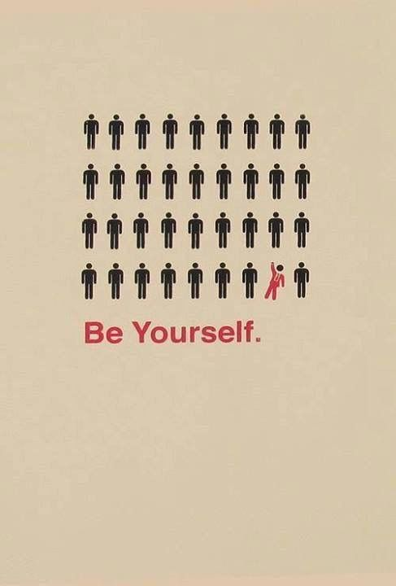
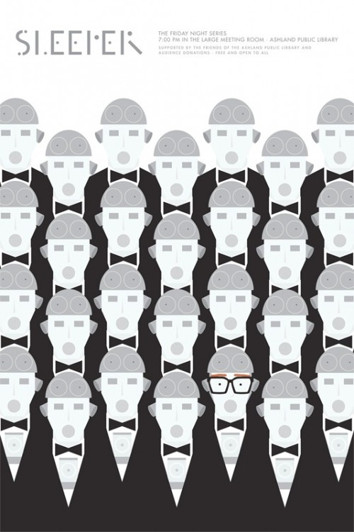
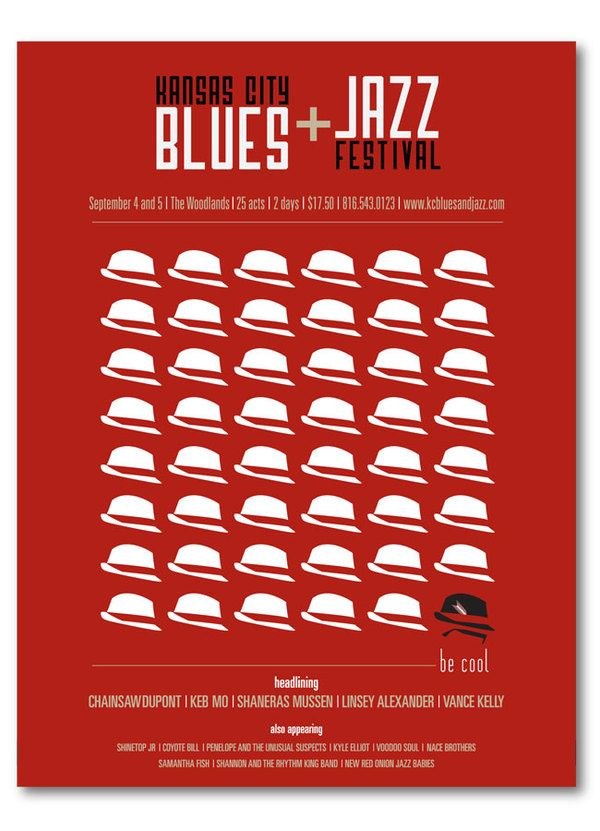
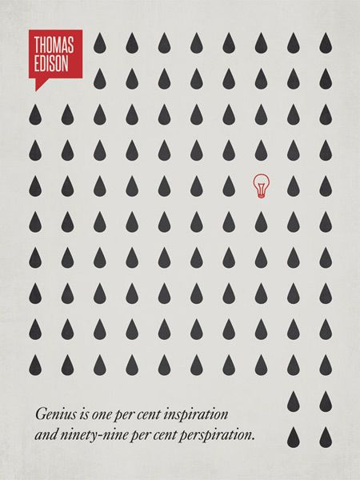

# 02-相似原则案例分析

本页记录以该专题为主分类的图例。图中可见事实、视觉组织分析和可尝试的设计做法分别记录。 [原则定义](02-相似原则-Similarity.md)

### G03

**Be Yourself. 人形阵列**

图源为用户提供的《Gestalt格式塔视觉组织.zip》中的 `Gestalt图片 (3).jpg`。

- **图中可见。** 黑色人形按近似网格重复，右下附近有一个红色且姿态不同的人形；标语也用红色。
- **组织原理。** 一致造型与排列建立基准组，色彩和姿态的双重差异使一个例外先被发现；红色把例外与标语联系起来。
- **设计实践。** 在重复符号中标记重点，可同时使用色彩与可识别的形态差异。转灰度后仍应能找出目标，图例注明强调含义。
- **辅助线索。** [16-边界对比与视觉情境](../16-边界对比与视觉情境/16-边界对比与视觉情境.md)

### G07

**SLEEPER 交错人物阵列**

图源为用户提供的《Gestalt格式塔视觉组织.zip》中的 `Gestalt图片 (7).jpg`。

- **图中可见。** 相近的头部、领结和深色衣身交错排列；靠下的一张脸增加了深色眼镜。
- **组织原理。** 同样的轮廓让多行人物被读成同一阵列。眼镜占面不大，但改变面部内部图案，足以锁定从属同组的个体。
- **设计实践。** 重复图标中可仅修改目标内部的一个特征。用缩略图检查例外是否可见，再核对读者仍把它认作同类。
- **辅助线索。** [01-接近原则](../01-接近原则/01-接近原则-Proximity.md) · [16-边界对比与视觉情境](../16-边界对比与视觉情境/16-边界对比与视觉情境.md)

### G16

**爵士节帽子网格中的异色帽**

图源为用户提供的《Gestalt格式塔视觉组织.zip》中的 `Gestalt图片 (16).jpg`。

- **图中可见。** 浅色礼帽以相近尺寸、倾斜角度和网格间距排列，右下方出现深色帽形。
- **组织原理。** 帽子的外形与规律位置先建立同类组。深色帽仍保持类别特征，却通过明暗差成为网格中的例外。
- **设计实践。** 在整齐排列的类别标记中，若用色彩标记异常，应保持轮廓一致并补文字说明，使异常仍能归回同组。
- **辅助线索。** [16-边界对比与视觉情境](../16-边界对比与视觉情境/16-边界对比与视觉情境.md)

### G24

**Thomas Edison 水滴阵列中的灯泡**

图源为用户提供的《Gestalt格式塔视觉组织.zip》中的 `Gestalt图片 (24).jpg`。

- **图中可见。** 深色水滴以一致图样和间距重复，一个小灯泡以红色轮廓置于阵列内部；下方有百分比文案。
- **组织原理。** 灯泡由形和色同时偏离水滴组，但仍占据类似网格位置。多数与例外的视觉对照服务文案；图符实际计数和百分比口径需另核。
- **设计实践。** 用象形阵列表示比例时注明每个符号代表的量，逐行核对数量。若是修辞性插图，用文字交代含义，避免暗示比例能由图符精确读出。
- **辅助线索。** [16-边界对比与视觉情境](../16-边界对比与视觉情境/16-边界对比与视觉情境.md)

[返回案例索引](../00-Gestalt概念与原则总览/37组案例索引.md)
