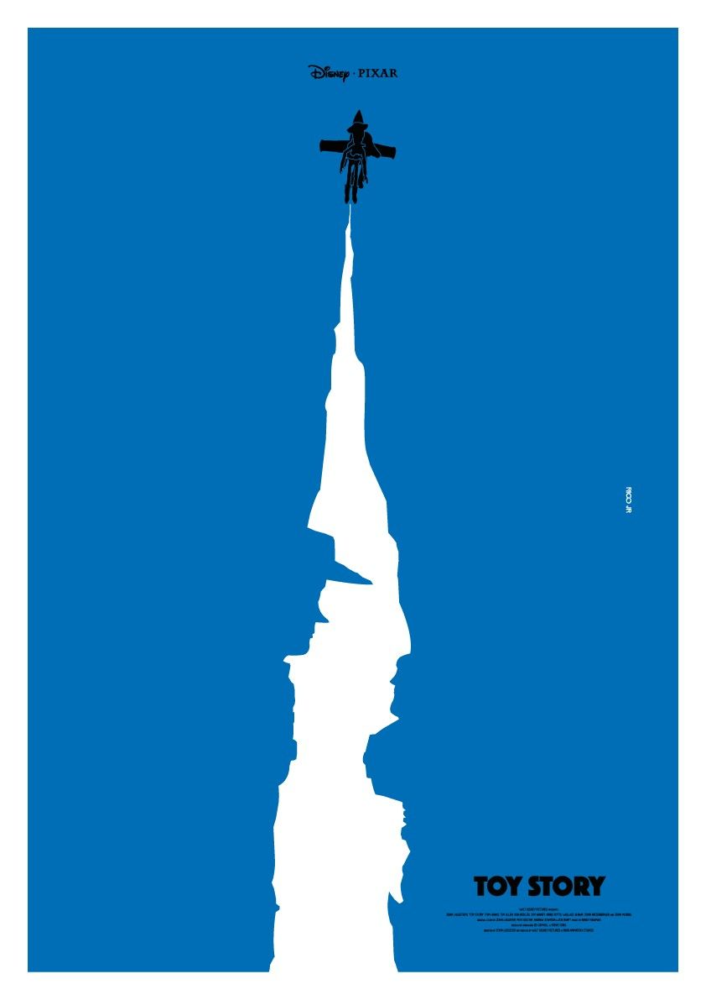

# 03-良好连续原则案例分析

本页记录以该专题为主分类的图例。图中可见事实、视觉组织分析和可尝试的设计做法分别记录。 [原则定义](03-良好连续原则-Good-Continuation.md)

### G12

**Toy Story 中央白形与顶部剪影**

图源为用户提供的《Gestalt格式塔视觉组织.zip》中的 `Gestalt图片 (12).jpg`。

- **图中可见。** 白色竖形由宽到窄，尖端与顶部深色小剪影对齐；白形边缘有多个明显的侧向转折。
- **组织原理。** 读者可沿连续的窄化方向从下部追到顶端，局部转折则引导读者在蓝白边界寻找侧影。垂直主路径组织了上下信息。
- **设计实践。** 设计纵向阅读路径时，可用连续位移和明确终点维持追踪，再用边缘细节补充第二层。检查转折是否会把视线引到错误模块。
- **辅助线索。** [11-图底组织](../11-图底组织/11-图底组织-Figure-Ground.md) · [04-闭合原则](../04-闭合原则/04-闭合原则-Closure.md)

### G22

**白色鱼形向远处汇聚**

图源为用户提供的《Gestalt格式塔视觉组织.zip》中的 `Gestalt图片 (22).jpg`。

- **图中可见。** 蓝底上的白色鱼形随画面走向逐渐变小、变密，形成弧向排列并向上方收束。
- **组织原理。** 相邻鱼形的排布、朝向与大小变化支持多条平滑轨迹，使视线顺着群体走向收束点。动势来自静态布置。
- **设计实践。** 在路径图中保持列间方向逐步过渡，用清楚的终点说明路径作用。若渐变大小没有统计含义，在数据图里避免让读者把它当成数量差。
- **辅助线索。** [02-相似原则](../02-相似原则/02-相似原则-Similarity.md) · [07-共同命运原则](../07-共同命运原则/07-共同命运原则-Common-Fate.md) · [16-边界对比与视觉情境](../16-边界对比与视觉情境/16-边界对比与视觉情境.md)

[返回案例索引](../00-Gestalt概念与原则总览/37组案例索引.md)
