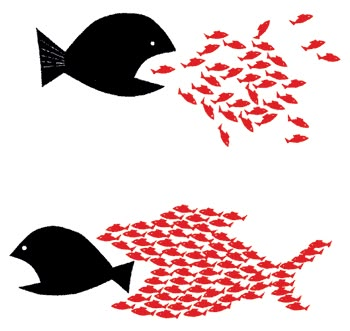

# 04-闭合原则案例分析

本页记录以该专题为主分类的图例。图中可见事实、视觉组织分析和可尝试的设计做法分别记录。 [原则定义](04-闭合原则-Closure.md)

### G10

**Men in Black 零件拼成虫形**

图源为用户提供的《Gestalt格式塔视觉组织.zip》中的 `Gestalt图片 (10).jpg`。

- **图中可见。** 大量深色小物件在中轴附近密集排列，外侧伸出左右肢体和两根触角，外边界由分散片段暗示。
- **组织原理。** 小物件的间隔在近看时可见，远看时外肢、分节和轴线支持虫形的轮廓补全。大形成立后还能回到局部辨认零件。
- **设计实践。** 先锁定总体轮廓和关键转折，再摆放可辨认的小单元。分别用整图与局部裁切检验整体和细节是否都成立。
- **辅助线索。** [01-接近原则](../01-接近原则/01-接近原则-Proximity.md) · [09-对称原则](../09-对称原则/09-对称原则-Symmetry.md)

### G15

**散开的鱼群与聚成的大鱼**

图源为用户提供的《Gestalt格式塔视觉组织.zip》中的 `Gestalt图片 (15).jpg`。

- **图中可见。** 上幅红色小鱼较散；下幅同类小鱼排成明确的大鱼轮廓，黑鱼与群体的位置也发生变化。
- **组织原理。** 密集的重复鱼形在下幅形成可补全的头身尾轮廓。两幅的朝向与位置暗示动作，聚合造型可由静态图直接确认。
- **设计实践。** 用对照图说明群体组织时保持小单元样式一致，只改变排列。若要说明移动的共同命运，可加时间连续的画面验证。
- **辅助线索。** [01-接近原则](../01-接近原则/01-接近原则-Proximity.md) · [02-相似原则](../02-相似原则/02-相似原则-Similarity.md) · [07-共同命运原则](../07-共同命运原则/07-共同命运原则-Common-Fate.md)

### G18

**Madagascar 企鹅组像**

图源为用户提供的《Gestalt格式塔视觉组织.zip》中的 `Gestalt图片 (18).jpg`。

- **图中可见。** 白腹与大片白底相接，黑色头背、翅膀和橙色喙分散在画面底部。
- **组织原理。** 局部黑边与喙为每个身体提供位置线索，读者补全缺失的白色轮廓，近距离的若干个体同时被看成一个角色组。
- **设计实践。** 浅色对象与底色相近时可保留关键关节和方向线索。测试四个头部与身体是否能一一对应，避免轮廓并错。
- **辅助线索。** [01-接近原则](../01-接近原则/01-接近原则-Proximity.md) · [11-图底组织](../11-图底组织/11-图底组织-Figure-Ground.md)

### G30

**被人物剪影打断的红色 12**

图源为用户提供的《Gestalt格式塔视觉组织.zip》中的 `Gestalt图片 (30).jpg`。

- **图中可见。** 大号红色数字与黑色人物剪影及灰色投影交叠，数字部分边缘被遮住。
- **组织原理。** 可见的笔画段仍提供熟悉数字的轮廓，读者可跨越遮挡补全。红色数字承担背景层次，前景人物也能被识别。
- **设计实践。** 若把大字号作为叙事背景，先保留笔画的关键转折。实际数据值应完整标出，验证遮挡不会导致 12 与其他数字混读。
- **辅助线索。** [03-良好连续原则](../03-良好连续原则/03-良好连续原则-Good-Continuation.md) · [11-图底组织](../11-图底组织/11-图底组织-Figure-Ground.md)

### G35

**双手与留白中的面包**

图源为用户提供的《Gestalt格式塔视觉组织.zip》中的 `Gestalt图片 (35).jpg`。

- **图中可见。** 两只深色手从对角伸来，手掌之间留出橙色空间，三条深色短弧在其间排列。
- **组织原理。** 手缘只给出部分边界，内部短弧像面包上的割纹，读者据此补齐缺失的轮廓。对角手势给出了物体所在范围。
- **设计实践。** 用局部线索暗示对象时，可将轮廓提示与物体特征放在同一区。遮住短弧作对照，检验对象是否仍可识别。
- **辅助线索。** [11-图底组织](../11-图底组织/11-图底组织-Figure-Ground.md) · [03-良好连续原则](../03-良好连续原则/03-良好连续原则-Good-Continuation.md)

[返回案例索引](../00-Gestalt概念与原则总览/37组案例索引.md)
