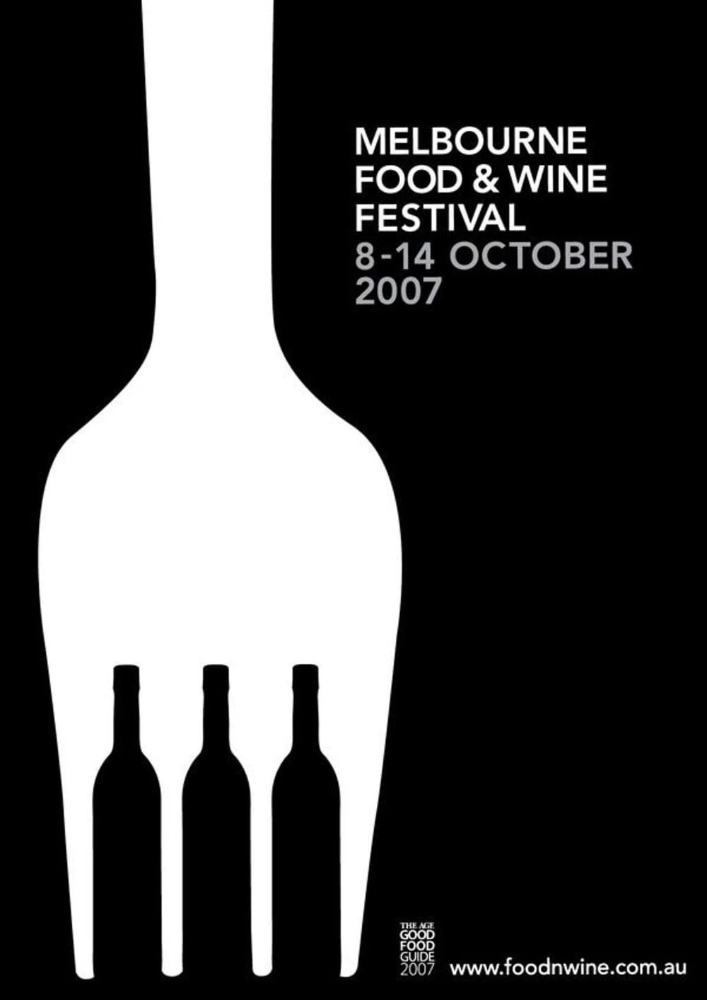
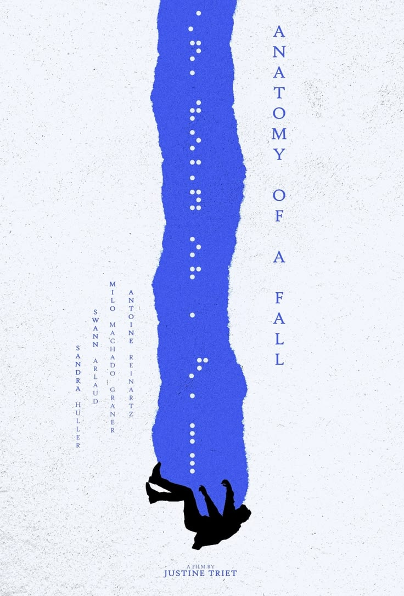

# 05-共同区域原则案例分析

本页记录以该专题为主分类的图例。图中可见事实、视觉组织分析和可尝试的设计做法分别记录。 [原则定义](05-共同区域原则-Common-Region.md)

### G27

**Melbourne Food & Wine Festival 餐叉与酒瓶**

图源为用户提供的《Gestalt格式塔视觉组织.zip》中的 `Gestalt图片 (27).jpg`。

- **图中可见。** 白色大形似餐叉，叉端组内的三个深色酒瓶状间隙近似同形，外围为黑底。
- **组织原理。** 白色外形限定了叉端的共同范围，三个插入其间的深色形因此形成一组。黑白反转时又能各自读作酒瓶，连接食物与酒主题。
- **设计实践。** 在一个容器中组织多项时，用共同边界维持所属关系。若留白兼作第二形，需检查底部开口是否使容器归属含混。
- **辅助线索。** [11-图底组织](../11-图底组织/11-图底组织-Figure-Ground.md) · [02-相似原则](../02-相似原则/02-相似原则-Similarity.md)

### G29

**Anatomy of a Fall 蓝带内的点列**

图源为用户提供的《Gestalt格式塔视觉组织.zip》中的 `Gestalt图片 (29).jpg`。

- **图中可见。** 竖向蓝色窄带圈定若干白点，坠落剪影位于带尾，标题沿带外侧竖排。
- **组织原理。** 蓝带把散点组织为同一列内的内容，竖向连续性把读者带到末端。标题位置与点带相邻，仍可通过带边界分清内外。
- **设计实践。** 在同页放置顺序列和外侧注释时，可用连续浅底限定列的数据区。检查读者是否会把栏外注释误认为列内记录。
- **辅助线索。** [03-良好连续原则](../03-良好连续原则/03-良好连续原则-Good-Continuation.md) · [10-平行原则](../10-平行原则/10-平行原则-Parallelism.md)

[返回案例索引](../00-Gestalt概念与原则总览/37组案例索引.md)
