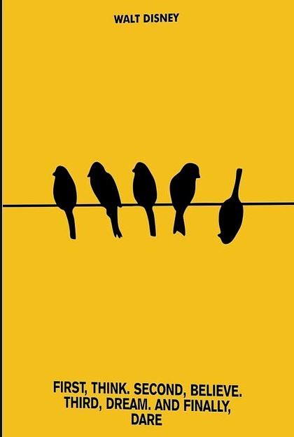
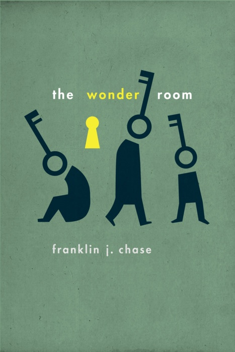
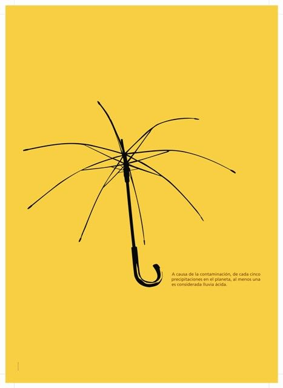
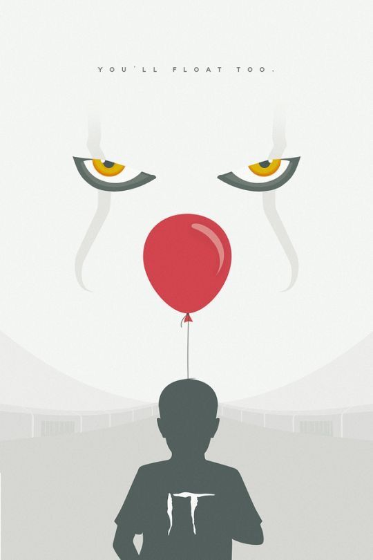

# 06-连接原则案例分析

本页记录以该专题为主分类的图例。图中可见事实、视觉组织分析和可尝试的设计做法分别记录。 [原则定义](06-连接原则-Connectedness.md)

### G09

**共用横线的五只鸟**

图源为用户提供的《Gestalt格式塔视觉组织.zip》中的 `Gestalt图片 (9).jpg`。

- **图中可见。** 五个黑色剪影与同一水平线相接，右侧个体倒挂，其余大体站在横线上。
- **组织原理。** 横线为所有个体提供持续的共同支撑，姿态改变仍不影响归组。右端倒挂处打破重复，使最后一个物体获得更高注意。
- **设计实践。** 流程图或时间轴可让同类节点接到同一基线，再单独突出例外。公共线须明确表示实际关系，避免与相邻组连错。
- **辅助线索。** [02-相似原则](../02-相似原则/02-相似原则-Similarity.md) · [03-良好连续原则](../03-良好连续原则/03-良好连续原则-Good-Continuation.md)

### G11

**The Wonder Room 钥匙与人物**

图源为用户提供的《Gestalt格式塔视觉组织.zip》中的 `Gestalt图片 (11).jpg`。

- **图中可见。** 三把深色钥匙的圆环与人物躯干上缘相接，形成钥匙头人物；黄色锁孔独立于三人之间。
- **组织原理。** 接触把原本可独立辨认的钥匙与身体合成复合标记。重复的复合形建立队列，黄色锁孔成为参照焦点。
- **设计实践。** 制定复合图标时让接合处在小尺寸下仍可见。用分离与相接两稿测试人们是否会把两个部件读成同一对象。
- **辅助线索。** [02-相似原则](../02-相似原则/02-相似原则-Similarity.md) · [16-边界对比与视觉情境](../16-边界对比与视觉情境/16-边界对比与视觉情境.md)

### G32

**伞骨、中心节点与弯柄**

图源为用户提供的《Gestalt格式塔视觉组织.zip》中的 `Gestalt图片 (32).jpg`。

- **图中可见。** 多条深色细线在黄色背景中央相接，再沿竖向主杆接到弯柄；伞面边缘未画满。
- **组织原理。** 交汇点、主杆和弯柄把细线组织成一个伞架，读者沿辐条能回到同一节点。保留骨架足以提示整体对象。
- **设计实践。** 连接图可用清晰的节点和线端维持归属。去掉填充面后仍应让读者准确指出哪些线真的相接。
- **辅助线索。** [03-良好连续原则](../03-良好连续原则/03-良好连续原则-Good-Continuation.md) · [12-简洁与良好形态原则](../12-简洁与良好形态原则/12-简洁与良好形态原则-Pragnanz.md)

### G37

**IT 气球、系线与下方人物**

图源为用户提供的《Gestalt格式塔视觉组织.zip》中的 `Gestalt图片 (37).jpg`。

- **图中可见。** 上部零散眼部细节和浅灰边缘提示一张脸；中央红气球与下方人物沿同一轴排列，细线从气球接到人物轮廓。
- **组织原理。** 细线将气球与人物组织为一组，附近的眼部和浅灰边缘可另行补全为大脸。中心气球同时参与局部连接与整体读法。
- **设计实践。** 若一个标记同时服务两层叙事，应让真实连接的端点清楚，并把作为背景的轮廓降到较低对比。按屏幕实际尺寸检查细线不断开。
- **辅助线索。** [04-闭合原则](../04-闭合原则/04-闭合原则-Closure.md) · [11-图底组织](../11-图底组织/11-图底组织-Figure-Ground.md)

[返回案例索引](../00-Gestalt概念与原则总览/37组案例索引.md)
