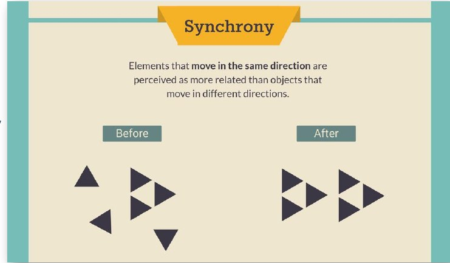

# 07 共同命运原则（Common Fate）

## 定义

以相近方式移动的元素容易被视为一组。广义共同命运还包括亮度等属性的同向变化。

## 边界

共同移动可以来自视图切换。只有数据和动画都支持时，才可把共同运动解释为迁移或相同变化。

## 示例

设计示例为动态地图上同一组点沿同一方向移动。

## 设计分析

共享的运动方向可帮助读者跟踪散布的点，但同步发生的反向变化还可产生同步性分组。

## 实践建议

分别检查动画前、中、后的类别归属，用静态标签补充运动信息。

## 课件图例与设计实践

*课件图例，PDF 第 40 页。*

第 40 页，§6.2.7 图例里的同向线索。该页标题为「同步原则」，插图文字讨论的是同方向运动带来的归组，右侧三角形统一朝向右方。静态图能直接观察到三角形朝向，图注进一步把这种朝向用于示意运动方向。

**设计实践。** 如果动态图要按移动方向分组，可让组内标记保持相近的运动方向，并用错开启动时间的版本检查读者是否仍能按方向识别。第 41 页的圆框图例详见[共同区域原则](../05-共同区域原则/05-共同区域原则-Common-Region.md)。 [《交互信息设计_编辑版(1)》](../15-参考文献与术语对照/15-参考文献与术语对照.md#用户提供的课件)

## 参考

[Wagemans 等，2012，视觉组织综述](https://elderlab.yorku.ca/wp-content/uploads/2016/12/WagemansPsychBull12.pdf) · [Wertheimer，1923，知觉形式的组织规律（1938 英译）](https://psychclassics.yorku.ca/Wertheimer/Forms/forms.htm)

[返回目录](../README.md)
