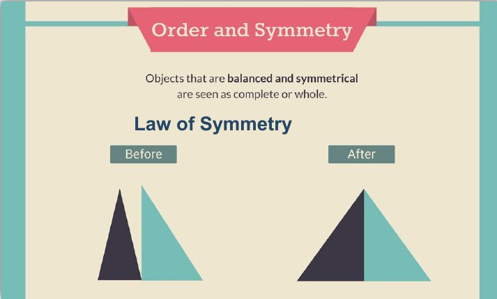

# 09 对称原则（Symmetry）

## 定义

具有镜像对称关系的边缘或部件容易被组织成一个形状。

## 边界

镜像布局可形成配对结构，数据量仍由长度、基线和尺度编码。

## 示例

设计示例为以中央零线为轴的镜像条形图。

## 设计分析

左右两栏对齐便于配对，但尺度不同时，形状相近可能造成数值相近的错觉。

## 实践建议

比较同一指标时共享尺度和零线，配对行保持同一垂直位置，并给出数值单位。

## 课件图例与设计实践

*课件图例，PDF 第 38 页。*

第 38 页，§6.2.5「对称原则」。右侧深色和青色三角形围绕中线形成镜像外轮廓。从外轮廓读，可以辨认出一个整体三角形，从色块读，仍可区分左右部分。

**设计实践。** 制作左右对照图时可用共用基线和对齐位置组织对应项。若两侧条形承载数据，按各自数值确定长度，并使用相同尺度。 [《交互信息设计_编辑版(1)》](../15-参考文献与术语对照/15-参考文献与术语对照.md#用户提供的课件)

## 参考

[Wagemans 等，2012，视觉组织综述](https://elderlab.yorku.ca/wp-content/uploads/2016/12/WagemansPsychBull12.pdf)

[返回目录](../README.md)
