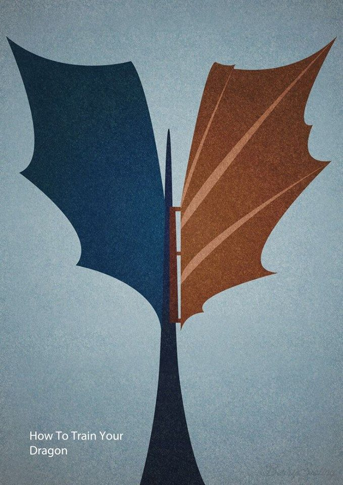
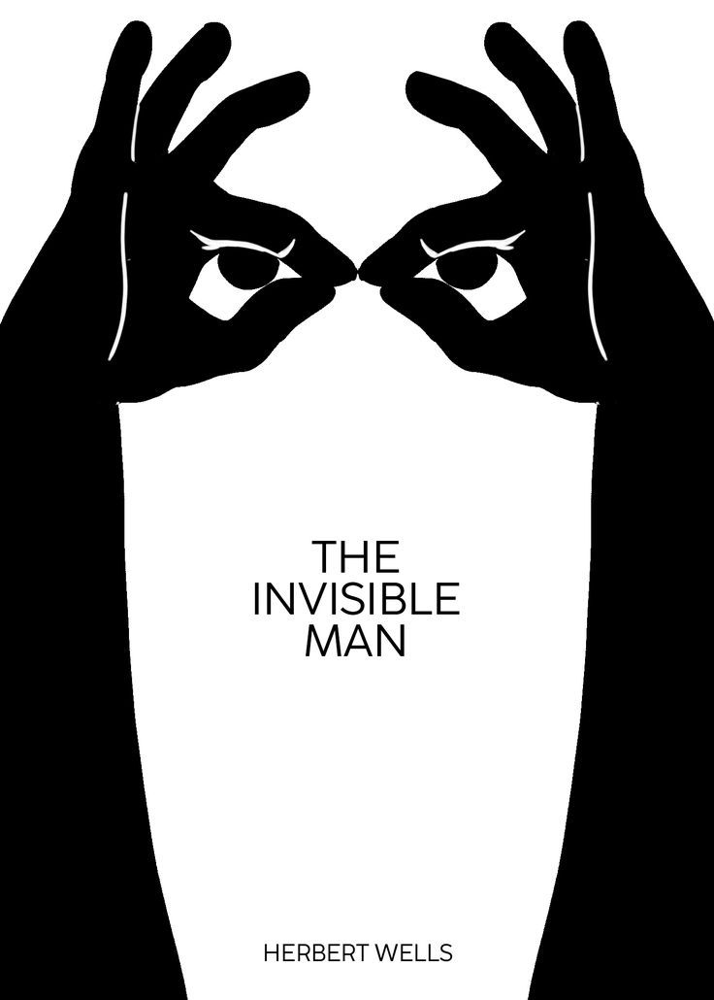
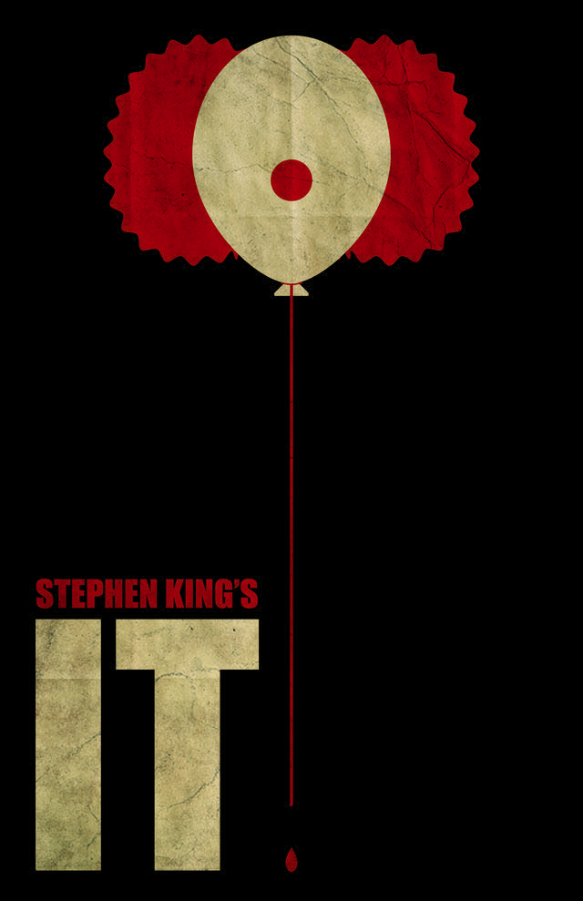

# 09-对称原则案例分析

本页记录以该专题为主分类的图例。图中可见事实、视觉组织分析和可尝试的设计做法分别记录。 [原则定义](09-对称原则-Symmetry.md)

### G17

**How To Train Your Dragon 两侧翼形**

图源为用户提供的《Gestalt格式塔视觉组织.zip》中的 `Gestalt图片 (17).jpg`。

- **图中可见。** 蓝色和棕色翼形各据中轴一侧，外缘大体呼应；棕翼有内部骨条并经小横段连接中轴。
- **组织原理。** 围绕共同轴线的近似对称让两翼被读为一个整体。差异集中在颜色和结构内线，使两侧可比较，同时保留连接关系。
- **设计实践。** 对照构图可共用轴线并保留真实差异。若用于数据比较，让长度或面积按独立数值计算，别用镜像复制数据。
- **辅助线索。** [06-连接原则](../06-连接原则/06-连接原则-Connectedness.md) · [11-图底组织](../11-图底组织/11-图底组织-Figure-Ground.md)

### G23

**The Invisible Man 双手与隐形面孔**

图源为用户提供的《Gestalt格式塔视觉组织.zip》中的 `Gestalt图片 (23).jpg`。

- **图中可见。** 两只深色手围绕中轴大体镜像，指环状空隙内有眼状细节；白色中部不画完整脸。
- **组织原理。** 对称稳定了双手与双眼的配对，中央空白因此可读作被暗示的脸，读者在手形和脸形之间切换。
- **设计实践。** 需要成对对照时，共用轴能帮助定位相应项。测试时独立移动一侧，观察何时破坏整体感，保留有含义的不对称。
- **辅助线索。** [11-图底组织](../11-图底组织/11-图底组织-Figure-Ground.md) · [04-闭合原则](../04-闭合原则/04-闭合原则-Closure.md)

### G36

**IT 红色发形与气球**

图源为用户提供的《Gestalt格式塔视觉组织.zip》中的 `Gestalt图片 (36).jpg`。

- **图中可见。** 浅色气球居中，两侧红色团块近似镜像，正中有红点，下方细线沿轴线垂落。
- **组织原理。** 上下中轴稳定了左右组合，双侧红形和中心红点又构成小丑脸式读法。气球线保持独立物件的识别线索。
- **设计实践。** 对称构图可用一个轴上焦点把两侧连接成整体。测试剪掉一侧或移动中心点后，双重读法是否明显减弱。
- **辅助线索。** [11-图底组织](../11-图底组织/11-图底组织-Figure-Ground.md) · [12-简洁与良好形态原则](../12-简洁与良好形态原则/12-简洁与良好形态原则-Pragnanz.md)

[返回案例索引](../00-Gestalt概念与原则总览/37组案例索引.md)
