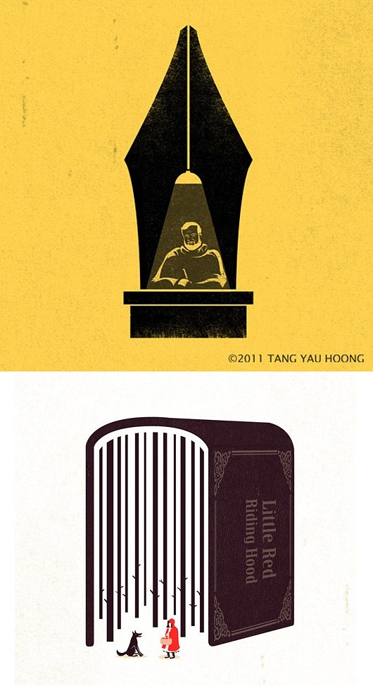
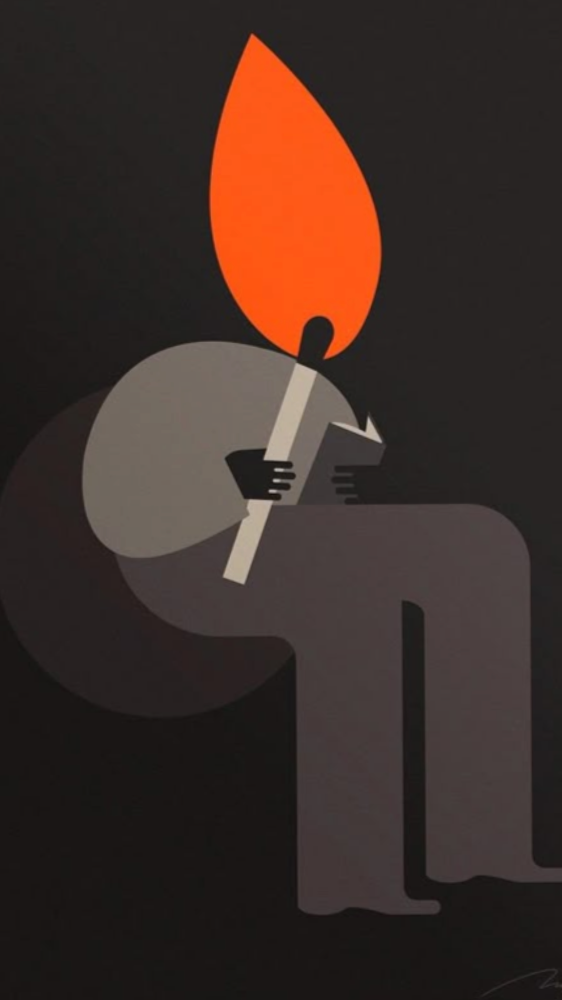
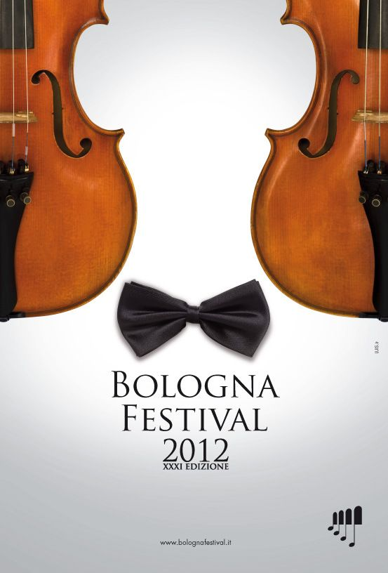
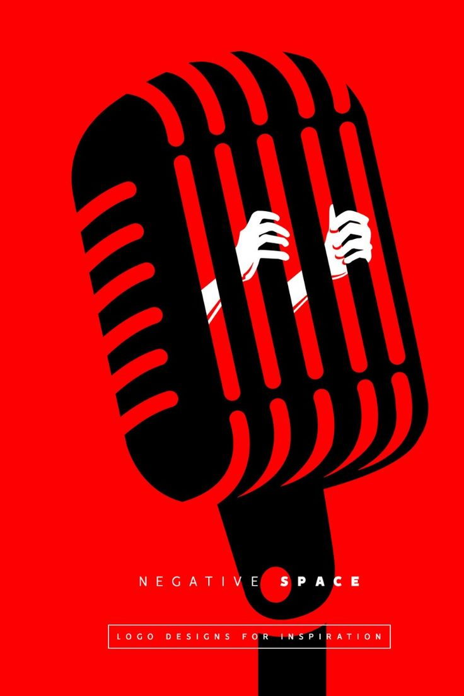
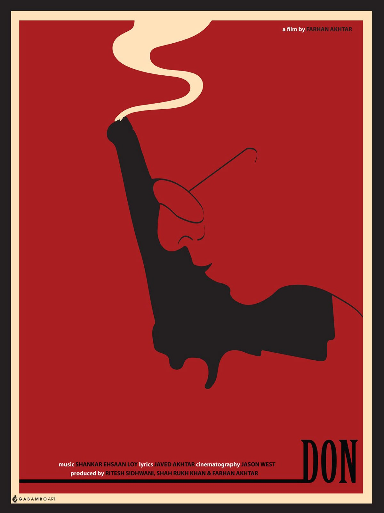
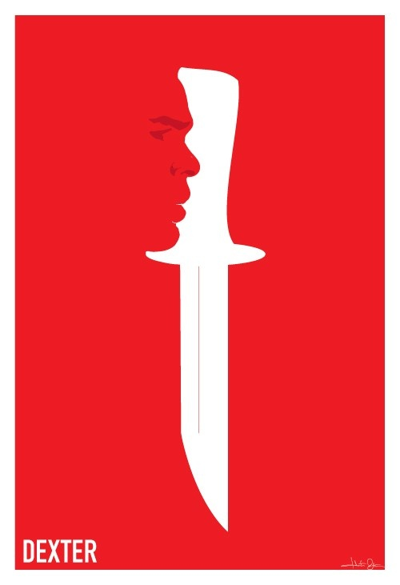
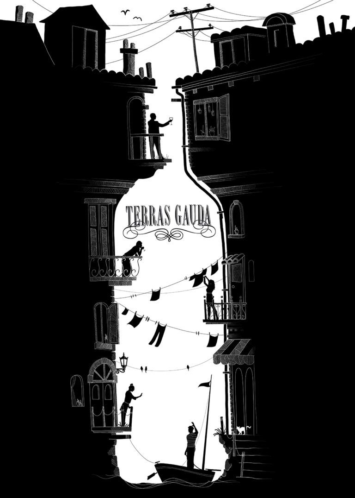
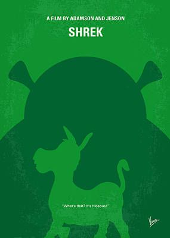
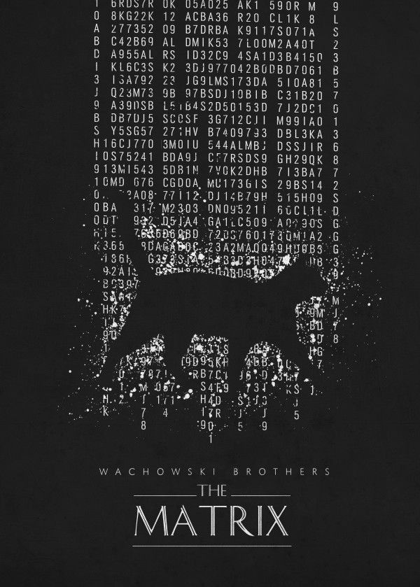
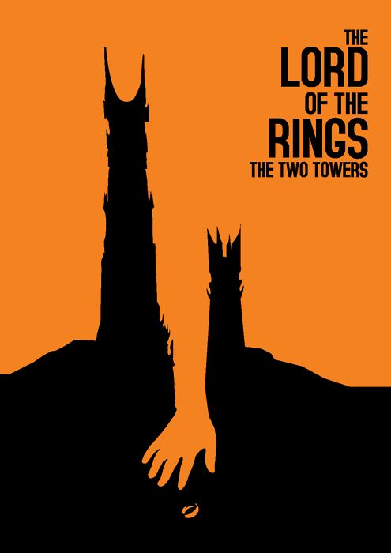

# 11-图底组织案例分析

本页记录以该专题为主分类的图例。图中可见事实、视觉组织分析和可尝试的设计做法分别记录。 [原则定义](11-图底组织-Figure-Ground.md)

### G01

**笔尖中的写作者与《小红帽》书页**

图源为用户提供的《Gestalt格式塔视觉组织.zip》中的 `Gestalt图片 (1).jpg`，其中上半幅可见 ©2011 Tang Yau Hoong。

- **图中可见。** 上半幅的黑色笔尖包围灯光与写作者；下半幅的书脊和封面包围多根近乎平行的竖线，红衣人物与狼置于线条下方。
- **组织原理。** 笔尖内部的亮处形成第二个可读场景。书页一侧的竖线既组成书页的整体排布，也可被读为林间树干；两幅各有一层大轮廓和一层嵌入线索。
- **设计实践。** 给主题页的主轮廓预留连续内区，把第二层信息放进明确的局部。缩略图上先问读者外轮廓是什么，再看能否找到内层提示。
- **辅助线索。** [03-良好连续原则](../03-良好连续原则/03-良好连续原则-Good-Continuation.md) · [05-共同区域原则](../05-共同区域原则/05-共同区域原则-Common-Region.md) · [10-平行原则](../10-平行原则/10-平行原则-Parallelism.md)

### G01B

**火柴照亮持物人物**

图源为用户提供的《Gestalt格式塔视觉组织.zip》中的 `Gestalt图片 (1).png`。

- **图中可见。** 橙色焰形、斜向浅色火柴杆和周围暗灰色块相接；手部在杆旁，人物躯干及腿隐入暗底。
- **组织原理。** 橙焰先从暗底中分离，斜杆再把焦点连到手和身体。边缘在低对比处变弱，读者可能先看到火焰，再发现人物。
- **设计实践。** 可用一个饱和色引导至关键部位，再通过可追踪的连接线揭示背景信息。降低亮度或转灰度后检查手与杆的关系是否仍清楚。
- **辅助线索。** [06-连接原则](../06-连接原则/06-连接原则-Connectedness.md) · [16-边界对比与视觉情境](../16-边界对比与视觉情境/16-边界对比与视觉情境.md)

### G02

**Bologna Festival 2012 双琴与领结**

图源为用户提供的《Gestalt格式塔视觉组织.zip》中的 `Gestalt图片 (2).jpg`。

- **图中可见。** 左右各有一段弦乐器琴身，向内凹的边共同限定中间白地；黑领结在白地与标题之间。
- **组织原理。** 先可辨认两边琴身；注视中间时，轮廓加领结又提示礼服前襟。左右对应稳定了中心位置，领结为第二次识别提供锚点。
- **设计实践。** 在音乐主题页可让两侧对象的内缘交代共同主题。缩小后核对领结仍落在白区中心，标题与白形互不干扰。
- **辅助线索。** [09-对称原则](../09-对称原则/09-对称原则-Symmetry.md) · [05-共同区域原则](../05-共同区域原则/05-共同区域原则-Common-Region.md)

### G04

**麦克风格栅与白手**

图源为用户提供的《Gestalt格式塔视觉组织.zip》中的 `Gestalt图片 (4).jpg`。

- **图中可见。** 黑色麦克风格栅占据红底中央，白手从几处红色狭缝之间露出。
- **组织原理。** 红色既构成外围背景，也穿入声头内部。白手把本可读为通风槽的间隙转成类似栏杆之间的空间，出现被困的第二层读法。
- **设计实践。** 要让同一空隙承担第二层含义，可用小面积局部线索触发切换。成品尺寸下检查白手清楚且不破坏麦克风轮廓。
- **辅助线索。** [04-闭合原则](../04-闭合原则/04-闭合原则-Closure.md)

### G08

**DON 烟线、手枪与人脸**

图源为用户提供的《Gestalt格式塔视觉组织.zip》中的 `Gestalt图片 (8).jpg`。

- **图中可见。** 乳白烟线连到黑色形体的上端；黑色形体的内缘与红底构成人脸侧影，红区另有眼镜线条。
- **组织原理。** 读者可沿烟线定位枪口，再沿红黑交界看到面孔。眼镜使侧影识别更明确，两个主体共用同一段边界。
- **设计实践。** 双重图底构图中，用一条清楚的外轮廓和一处辅助细节分别检验两种读法。不要让标题或数据标签打断转换所需的边界。
- **辅助线索。** [03-良好连续原则](../03-良好连续原则/03-良好连续原则-Good-Continuation.md)

### G14

**DEXTER 刀刃与红色侧脸**

图源为用户提供的《Gestalt格式塔视觉组织.zip》中的 `Gestalt图片 (14).jpg`。

- **图中可见。** 白色竖形具有刀的护手和刃尖，上端左侧的红白交界形成额头、鼻、嘴与下颌的起伏。
- **组织原理。** 先由完整白块识别刀，再由共享的局部边缘读出人脸；两种解释集中在同一轮廓附近。
- **设计实践。** 双义轮廓应优先确保大形完整，在局部保留容易辨认的转折。测试缩小后鼻、嘴等轮廓能否区别于普通锯齿。
- **辅助线索。** [03-良好连续原则](../03-良好连续原则/03-良好连续原则-Good-Continuation.md)

### G19

**Terras Gauda 街巷留白中的酒瓶**

图源为用户提供的《Gestalt格式塔视觉组织.zip》中的 `Gestalt图片 (19).jpg`。

- **图中可见。** 画面两侧为深色建筑，中部亮区的宽窄变化构成瓶口、瓶肩和瓶身，街景细节穿过亮区。
- **组织原理。** 建筑内缘共享亮区边界，先能读作街巷，也能重组为直立的酒瓶。瓶身的文字增强后者，街景仍提供场景语境。
- **设计实践。** 在留白形中放文字时避开瓶肩等识别转折。测试时先遮住品牌文字，判断轮廓能否独立被识别。
- **辅助线索。** [04-闭合原则](../04-闭合原则/04-闭合原则-Closure.md)

### G21

**SHREK 大头像和浅绿驴形**

图源为用户提供的《Gestalt格式塔视觉组织.zip》中的 `Gestalt图片 (21).jpg`。

- **图中可见。** 深绿头像随两侧耳朵形成大轮廓，浅绿驴形落入其下部，外围与内部绿调分层。
- **组织原理。** 明度差使读者先认出大头像，然后在深色区域内辨出另一角色。内嵌轮廓提供角色关联，面积层级使两形有主次。
- **设计实践。** 对有主次的图形采用两层可辨对比。转灰度与缩小后都应能分开轮廓，辅助文字避免贴到小形边缘。
- **辅助线索。** [05-共同区域原则](../05-共同区域原则/05-共同区域原则-Common-Region.md) · [16-边界对比与视觉情境](../16-边界对比与视觉情境/16-边界对比与视觉情境.md)

### G25

**The Matrix 字符雨中的黑色剪影**

图源为用户提供的《Gestalt格式塔视觉组织.zip》中的 `Gestalt图片 (25).jpg`。

- **图中可见。** 浅色字符在暗底上形成密集纵列，中央有一块由字符减少形成的深色剪影，边缘伴有散点。
- **组织原理。** 字符群建立局部背景，内部缺口被组织为主体。密度反差使人物式剪影可见，轮廓可由相邻字符终止的位置推断。
- **设计实践。** 若用缺口呈现主体，先检查外围纹理密度足以定义边缘。对照有无缺口的版本，确认读者能说出主体位置。
- **辅助线索。** [02-相似原则](../02-相似原则/02-相似原则-Similarity.md) · [04-闭合原则](../04-闭合原则/04-闭合原则-Closure.md)

### G34

**The Two Towers 双塔之间的手**

图源为用户提供的《Gestalt格式塔视觉组织.zip》中的 `Gestalt图片 (34).jpg`。

- **图中可见。** 两个不等高的深色塔形由下方暗色地面连起，塔间的橙色留白向下延伸，末端有明显手指轮廓。
- **组织原理。** 塔形先作为黑色主体成立，连续的橙色带再被重组为伸下的手，双塔内缘和手臂共用边界。
- **设计实践。** 在标题构图里用负形提示第二个叙事对象时，保留识别手势的分叉。测试读者能否先后定位两座塔和那只手。
- **辅助线索。** [04-闭合原则](../04-闭合原则/04-闭合原则-Closure.md) · [03-良好连续原则](../03-良好连续原则/03-良好连续原则-Good-Continuation.md)

[返回案例索引](../00-Gestalt概念与原则总览/37组案例索引.md)
