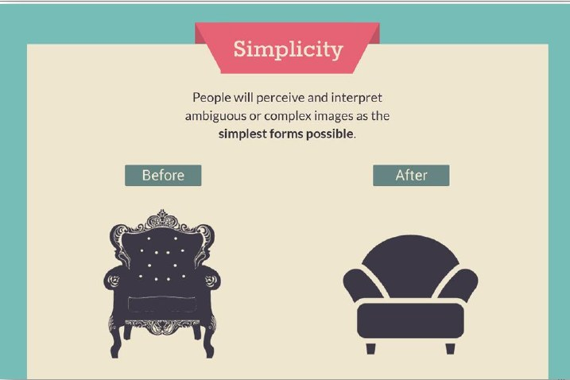

# 12 简洁与良好形态原则（Prägnanz）

## 定义

Prägnanz 描述知觉在给定条件下趋向形成较稳定、容易把握的整体组织。简洁是可能的组织特征之一。

## 边界

该原则关注读者如何组织知觉。设计中的元素数量最少并非充分条件，详见研究对良好形态的讨论。

## 示例

设计示例为在一组小多图中统一阅读方向、比例尺与图例位置。

## 设计分析

可预测的结构能让读者集中比较变量。移除必要基准或异常说明会削弱理解。

## 实践建议

对照不同版式，分别检查读者能否读出整体模式、准确数值和关键例外。

## 课件图例与设计实践

*课件图例，PDF 第 35 页。*

第 35 页，§6.2.2「简单原则」。图例把细节繁复的扶手椅与保留椅背、扶手和座面的简化椅形并置。这组图适合说明如何保留类别识别所需的结构线索。

**设计实践。** 绘制信息图形图标时，逐步减少纹样和次要细节，再请读者辨认对象。若删减后容易与同组其他图标混淆，可恢复具有区分作用的局部特征。 [《交互信息设计_编辑版(1)》](../15-参考文献与术语对照/15-参考文献与术语对照.md#用户提供的课件)

## 参考

[Wagemans 等，2012，视觉组织综述](https://elderlab.yorku.ca/wp-content/uploads/2016/12/WagemansPsychBull12.pdf) · [Van Geert 与 Wagemans，2024，良好形态原则综述](https://pubmed.ncbi.nlm.nih.gov/37787874/)

## 案例图与设计实践

[查看本专题的案例图片、视觉组织分析与设计实践](案例分析.md)

[返回目录](../README.md)
