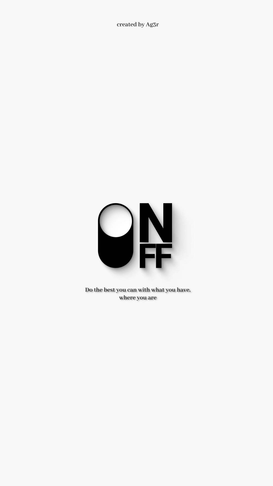
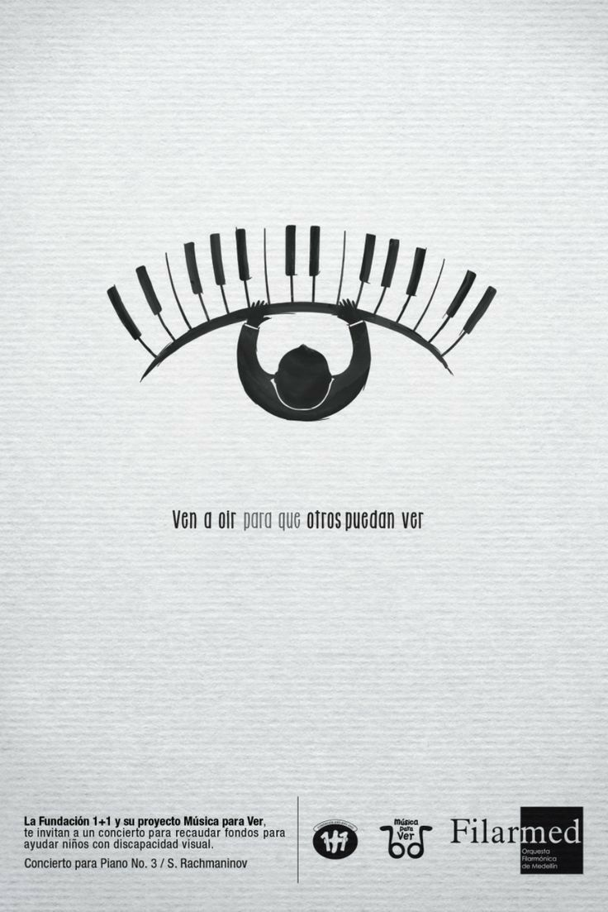
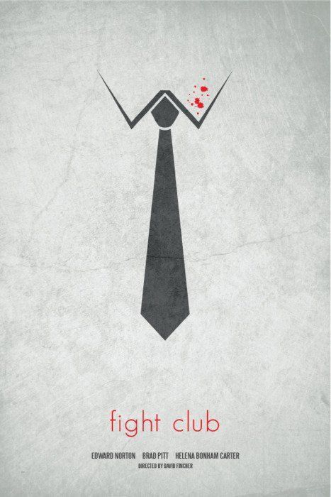
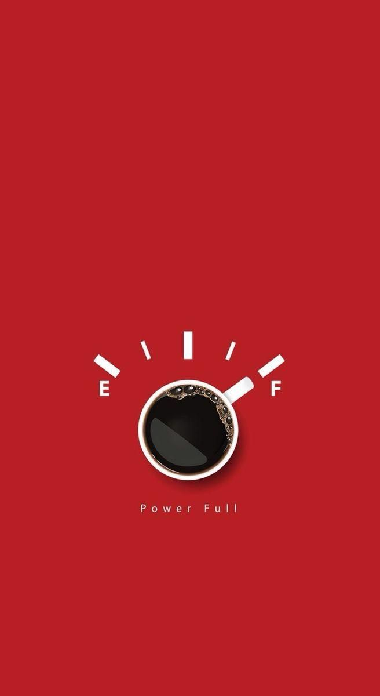

# 12-简洁与良好形态原则案例分析

本页记录以该专题为主分类的图例。图中可见事实、视觉组织分析和可尝试的设计做法分别记录。 [原则定义](12-简洁与良好形态原则-Pragnanz.md)

### G05

**ON/OFF 开关字形**

图源为用户提供的《Gestalt格式塔视觉组织.zip》中的 `Gestalt图片 (5).jpg`。

- **图中可见。** 黑色竖向圆角形与右侧紧邻字母组成小型字标；白圆在上方，ON 与 OFF 共享左侧 O 的形态。
- **组织原理。** 共用的左侧形状把开关控件与两个词压入同一个整体；大面积留白使读者首先定位该共享单元。
- **设计实践。** 设计共享符号时先检查两个词是否都能单独读出。若用于真实交互控件，再用位置和明确标签标出当前状态。
- **辅助线索。** [06-连接原则](../06-连接原则/06-连接原则-Connectedness.md) · [11-图底组织](../11-图底组织/11-图底组织-Figure-Ground.md)

### G13

**琴键弧线构成眼睛**

图源为用户提供的《Gestalt格式塔视觉组织.zip》中的 `Gestalt图片 (13).jpg`。

- **图中可见。** 黑白琴键绕弧排布，弧下只有少量黑色及留白的眼球细节。
- **组织原理。** 弧线相当于眼的上缘，中央深色圆形强化了眼睛读法；保留几个必要部件即可让两种熟悉形态同时可辨。
- **设计实践。** 设计概念图标时列出两种含义各自最必要的形态特征。先隐藏标题，请读者分别指出两层线索。
- **辅助线索。** [03-良好连续原则](../03-良好连续原则/03-良好连续原则-Good-Continuation.md) · [04-闭合原则](../04-闭合原则/04-闭合原则-Closure.md)

### G20

**Fight Club 衣领、领带与红点**

图源为用户提供的《Gestalt格式塔视觉组织.zip》中的 `Gestalt图片 (20).jpg`。

- **图中可见。** 黑色细折线提示衬衣领口，居中黑色领带和近领口的少量红点集中在浅灰背景上。
- **组织原理。** 领口与领带的位置关系足以提示一套穿着，无需画满身体。小面积红点与规整的居中结构形成破坏性差异。
- **设计实践。** 压缩图形细节时先保留对象间的相互位置。若红点承担警示含义，应让其和背景能可靠区分，并以标签解释。
- **辅助线索。** [09-对称原则](../09-对称原则/09-对称原则-Symmetry.md) · [16-边界对比与视觉情境](../16-边界对比与视觉情境/16-边界对比与视觉情境.md)

### G26

**Power Full 圆形与油量表**

图源为用户提供的《Gestalt格式塔视觉组织.zip》中的 `Gestalt图片 (26).jpg`。

- **图中可见。** 小幅中央图形将圆形部件、短刻度和 E、F 放在同一弧形区，四周是大面积红色。
- **组织原理。** 保留刻度、两端字母及指示部件即可唤起油量表结构。统一的集中位置使少量元素被读成一套仪表。
- **设计实践。** 极简仪表如承载数值，应补齐刻度含义和单位；概念图仍可利用 E、F 等关键识别点。缩略图上检查这些识别点有无丢失。
- **辅助线索。** [03-良好连续原则](../03-良好连续原则/03-良好连续原则-Good-Continuation.md) · [16-边界对比与视觉情境](../16-边界对比与视觉情境/16-边界对比与视觉情境.md)

[返回案例索引](../00-Gestalt概念与原则总览/37组案例索引.md)
