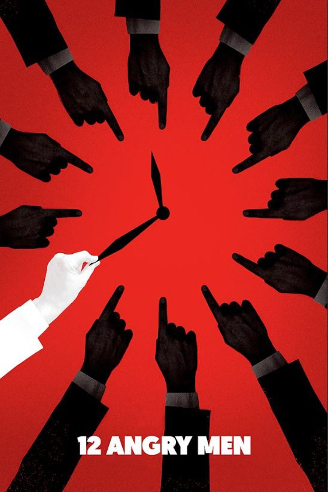
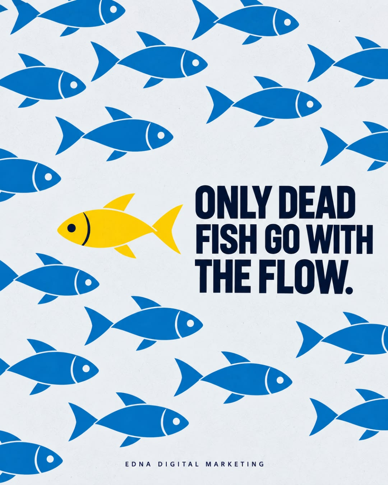

# 16-边界对比与视觉情境案例分析

本页记录以该专题为主分类的图例。图中可见事实、视觉组织分析和可尝试的设计做法分别记录。 [原则定义](16-边界对比与视觉情境.md)

### G06

**12 Angry Men 指尖与钟面**

图源为用户提供的《Gestalt格式塔视觉组织.zip》中的 `Gestalt图片 (6).jpg`。

- **图中可见。** 手臂从四周伸向红色中心，末端形成放射构图；中心有钟针，左下方的白手与其他深色手形成反差。
- **组织原理。** 各方向提供共同的中心参照。白手沿同一构图方向进入，但明度将它从重复手形中提取出来。画面可观察到静态指向。
- **设计实践。** 辐射注释应把线头明确指向证据区。测试读者先看到中心还是白手，并留出空间避免两者互相遮挡。
- **辅助线索。** [03-良好连续原则](../03-良好连续原则/03-良好连续原则-Good-Continuation.md) · [09-对称原则](../09-对称原则/09-对称原则-Symmetry.md)

### G33

**反向游动的黄色鱼**

图源为用户提供的《Gestalt格式塔视觉组织.zip》中的 `Gestalt图片 (33).jpg`。

- **图中可见。** 蓝鱼大多同向，黄色鱼在中部朝反方向，旁边配有关于随流的文字。
- **组织原理。** 统一的鱼形和朝向建立参照，反向且异色的鱼被快速挑出。静态图能确认朝向，画面语义提示移动。
- **设计实践。** 可用相反朝向和补充色标记偏离。如果要验证共同命运，另用动态版本，让不同组沿各自方向持续移动。
- **辅助线索。** [02-相似原则](../02-相似原则/02-相似原则-Similarity.md) · [07-共同命运原则](../07-共同命运原则/07-共同命运原则-Common-Fate.md)

[返回案例索引](../00-Gestalt概念与原则总览/37组案例索引.md)
