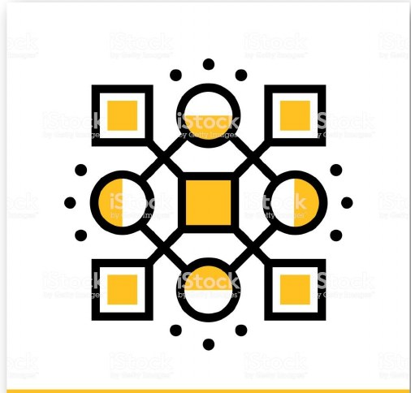

# Gestalt 概念与原则总览

格式塔视觉组织原则解释读者如何把局部标记看成组、轮廓、主体和背景，以及如何感知整体形态。对于信息图形，先明确数据中实际存在的类别、顺序与关系，再选择能够支持这些关系的视觉线索。

## 数量说明

文献没有公认的固定总数。本目录有 **12 份编号 01–12 的原则专题**，另有一份依据课件补充的[视觉组织线索专题](04-设计实践经验汇编/16-边界对比与视觉情境.md)。先前总览的 13 项知识点保留，元素连接与均一连接合写在一份文档，广义共同命运放在共同命运一节。综述将图底组织与分组分别讨论，良好形态涉及整体组织。 [Wagemans 等，2012，视觉组织综述](https://elderlab.yorku.ca/wp-content/uploads/2016/12/WagemansPsychBull12.pdf) · [Van Geert 与 Wagemans，2024，良好形态原则综述](https://pubmed.ncbi.nlm.nih.gov/37787874/)

| 编号 | 专题 | 定义 |
| --- | --- | --- |
| 01 | [接近原则](01-规则库/G01-接近律-Proximity.md) | 在其他条件相近时，空间距离较近的元素更容易被知觉为一组。 |
| 02 | [相似原则](01-规则库/G02-相似律-Similarity.md) | 颜色、形状、大小或朝向相近的元素更容易被组织在一起。 |
| 03 | [良好连续原则](01-规则库/G03-良好连续律-Good-Continuation.md) | 沿相近平滑方向延伸的边缘或线段，容易被组织为连续轮廓或路径。 |
| 04 | [闭合原则](01-规则库/G08-闭合律-Closure.md) | 接近围成封闭轮廓的片段容易形成一组。有时即使轮廓不完整，读者也会感知一个完整形状。 |
| 05 | [共同区域原则](01-规则库/G05-共同区域律-Common-Region.md) | 位于同一个可感知边界或容器内的元素容易被看成一组。 |
| 06 | [连接原则](01-规则库/G06-连接律-Connectedness.md) | **元素连接**指独立元素借接触、共享边界或可见连线形成一组。**均一连接**指相连且颜色、亮度或纹理等属性一致或平滑变化的区域容易被看成一个单元。 |
| 07 | [共同命运原则](01-规则库/G04-共同命运律-Common-Fate.md) | 以相近方式移动的元素容易被视为一组。广义共同命运还包括亮度等属性的同向变化。 |
| 08 | [同步原则](01-规则库/G07-同步律-Synchrony.md) | 可见变化在同一时刻发生时，元素可能被看成一组，变化方向可以不同。 |
| 09 | [对称原则](01-规则库/G09-对称律-Symmetry.md) | 具有镜像对称关系的边缘或部件容易被组织成一个形状。 |
| 10 | [平行原则](01-规则库/G10-平行律-Parallelism.md) | 平行或近似平行的边缘、线段或轨迹容易被看成一组。 |
| 11 | [图底组织](01-规则库/G11-图底关系-Figure–Ground-Organization.md) | 视觉将场景的部分区域组织为有形状、拥有共享边界的主体，周围区域作为背景。 |
| 12 | [简洁与良好形态原则](01-规则库/G12-良好形态原则-Prägnanz.md) | Prägnanz 描述知觉在给定条件下趋向形成较稳定、容易把握的整体组织。简洁是可能的组织特征之一。 |

## 课件章节对照

[《交互信息设计_编辑版(1)》](05-参考文献/README.md#用户提供的课件)第 33 页以模式识别引入格式塔视觉组织。图中的圆、方形、连接线和外围小点，可按相似性、连接关系及整体对称观察。以下为 PDF 文件页码。

*课件图例，PDF 第 33 页。*

| 页码 | 课件小节 | 仓库对应文档 |
| --- | --- | --- |
| 30–31 | §6.1 对比与情境 | [16 边界、对比与视觉情境](04-设计实践经验汇编/16-边界对比与视觉情境.md) |
| 34 | §6.2.1 邻近原则、接近原则 | [01 接近原则](01-规则库/G01-接近律-Proximity.md) |
| 35 | §6.2.2 简单原则 | [12 简洁与良好形态原则](01-规则库/G12-良好形态原则-Prägnanz.md) |
| 36 | §6.2.3 相似原则 | [02 相似原则](01-规则库/G02-相似律-Similarity.md) |
| 37 | §6.2.4 闭合原则 | [04 闭合原则](01-规则库/G08-闭合律-Closure.md) |
| 38 | §6.2.5 对称原则 | [09 对称原则](01-规则库/G09-对称律-Symmetry.md) |
| 39 | §6.2.6 连续性原则 | [03 良好连续原则](01-规则库/G03-良好连续律-Good-Continuation.md) |
| 40 | §6.2.7 同步原则，图注描述同向运动 | [08 同步原则](01-规则库/G07-同步律-Synchrony.md)和[07 共同命运原则](01-规则库/G04-共同命运律-Common-Fate.md) |
| 41 | §6.2.8 同域原则，插图标为 Common Region | [05 共同区域原则](01-规则库/G05-共同区域律-Common-Region.md) |
| 42 | §6.2.9 同构原则（异质同构） | [13 补充概念与边界](03-跨原则对照实验/README.md#课件中的同构示例) |
| 45 | §6.5 前景/背景识别 | [11 图底组织](01-规则库/G11-图底关系-Figure–Ground-Organization.md)和[16 边界、对比与视觉情境](04-设计实践经验汇编/16-边界对比与视觉情境.md) |

第 41 页侧栏并列出现 Common Fate 与 Region，图例中的成组依据是圆形边界。第 43–44 页的图表感知任务见[补充概念与边界](03-跨原则对照实验/README.md#从感知任务选择图表)。

## 与仓库的关系

01 记录信息图形的数据逻辑，02 记录信息图形类型与案例，03 研究 ISOTYPE，04 分析统计图形，05 记录视觉组织原则，06 管理具体选题设计。

**仓库案例。** Fortune 500 图把金额贴近地名，借引线建立圆标与地图落点的对应，并用白色突出纽约。重制时，可从每个圆标逐条追到落点，记录可能误读的交叉处。此处为版面观察，尚未做读者测试。 [Fortune 500 都会区营收图](../02-信息图形类型案例/07-地标型-Location/案例/CASE-0001-Fortune500都市圈营收分布/分析.md)

[返回目录](README.md)
