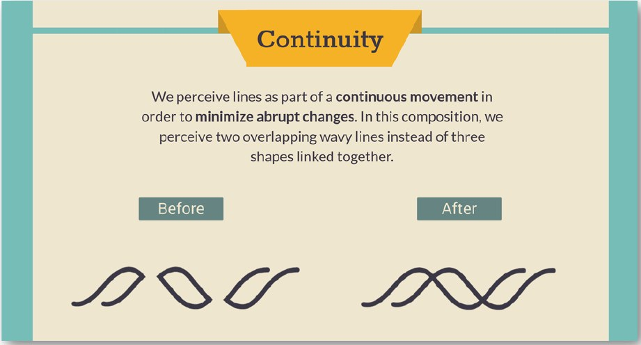

# G03 良好连续原则（Good Continuation）

## 定义

沿相近平滑方向延伸的边缘或线段，容易被组织为连续轮廓或路径。

## 边界

线条相交不一定表示数据关联。平滑连线也可能让读者把缺测或插值读成实测。

## 示例

设计示例为两条在高点附近交叉的时间序列。

## 设计分析

角度相近时，读者可能沿较平滑的方向追到另一条线。颜色、线型和端点标签有助于区分。

## 实践建议

检查最密集的交叉处，并用清晰断点或有图例的线型标示缺测、估计与实测。

## 课件图例与设计实践

*课件图例，PDF 第 39 页。*

第 39 页，§6.2.6「连续性原则」。左图分开的曲线片段与右图交叠的波线构成对照。右图交点两侧的延伸方向支持读者顺着两条路径追踪。

**设计实践。** 在线路图或多序列折线图中，从交叉之前的线段追到交叉之后，检查读者能否沿正确方向续读。必要时加端点标签或不同线型，并按数据口径标示区间缺测。 [《交互信息设计_编辑版(1)》](../05-参考文献/README.md#用户提供的课件)

## 参考

[Wagemans 等，2012，视觉组织综述](https://elderlab.yorku.ca/wp-content/uploads/2016/12/WagemansPsychBull12.pdf) · [Wertheimer，1923，知觉形式的组织规律（1938 英译）](https://psychclassics.yorku.ca/Wertheimer/Forms/forms.htm)

## 案例图与设计实践

[查看本专题的案例图片、视觉组织分析与设计实践](../02-案例库/README.md#规则-03)

[返回目录](../README.md)
