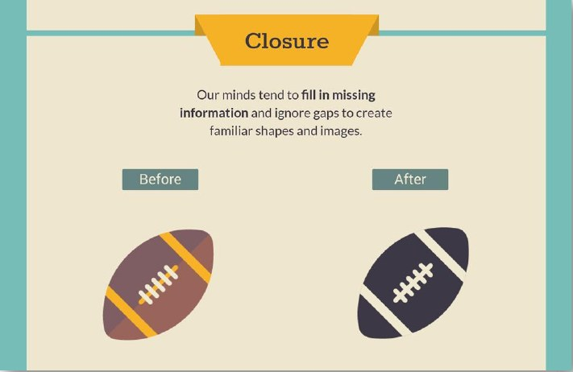

# G08 闭合原则（Closure）

## 定义

接近围成封闭轮廓的片段容易形成一组。有时即使轮廓不完整，读者也会感知一个完整形状。

## 边界

闭合与共同区域的侧重点不同。闭合关注轮廓如何形成整体，共同区域关注边界内的元素归组。

## 示例

设计示例为环形进度图中很小的未完成区段。

## 设计分析

当缺口太小，环形轮廓可能被补全，近满值就容易被误判为满值。

## 实践建议

保持缺口与背景的对比度，并显示精确百分比。在最终展示尺寸上核对近满值。

## 课件图例与设计实践

*课件图例，PDF 第 37 页。*

第 37 页，§6.2.4「闭合原则」。右侧橄榄球图形被两条浅色断带分隔，外缘片段仍沿着同一球形轮廓排列，允许读者把图形识别为一个整体。

**设计实践。** 简化图标时可删减部分轮廓，保留足以辨认对象的曲线和转折。把图标缩到成品尺寸检查识别情况，对表达数值的轮廓断点保留必要标记。 [《交互信息设计_编辑版(1)》](../05-参考文献/README.md#用户提供的课件)

## 参考

[Wagemans 等，2012，视觉组织综述](https://elderlab.yorku.ca/wp-content/uploads/2016/12/WagemansPsychBull12.pdf) · [Wertheimer，1923，知觉形式的组织规律（1938 英译）](https://psychclassics.yorku.ca/Wertheimer/Forms/forms.htm)

## 案例图与设计实践

[查看本专题的案例图片、视觉组织分析与设计实践](../02-案例库/README.md#规则-04)

[返回目录](../README.md)
