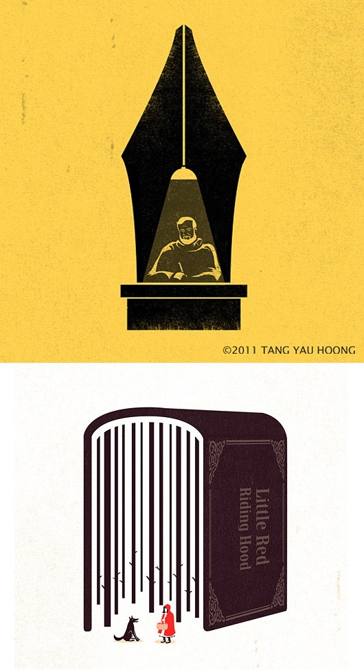

# 笔尖中的写作者与《小红帽》书页

### G01

**笔尖中的写作者与《小红帽》书页**

图源为用户提供的《Gestalt格式塔视觉组织.zip》中的 `Gestalt图片 (1).jpg`，其中上半幅可见 ©2011 Tang Yau Hoong。

- **图中可见。** 上半幅的黑色笔尖包围灯光与写作者；下半幅的书脊和封面包围多根近乎平行的竖线，红衣人物与狼置于线条下方。
- **组织原理。** 笔尖内部的亮处形成第二个可读场景。书页一侧的竖线既组成书页的整体排布，也可被读为林间树干；两幅各有一层大轮廓和一层嵌入线索。
- **设计实践。** 给主题页的主轮廓预留连续内区，把第二层信息放进明确的局部。缩略图上先问读者外轮廓是什么，再看能否找到内层提示。
- **辅助线索。** [03-良好连续原则](../../01-规则库/G03-良好连续律-Good-Continuation.md) · [05-共同区域原则](../../01-规则库/G05-共同区域律-Common-Region.md) · [10-平行原则](../../01-规则库/G10-平行律-Parallelism.md)

[返回案例库](../README.md)
