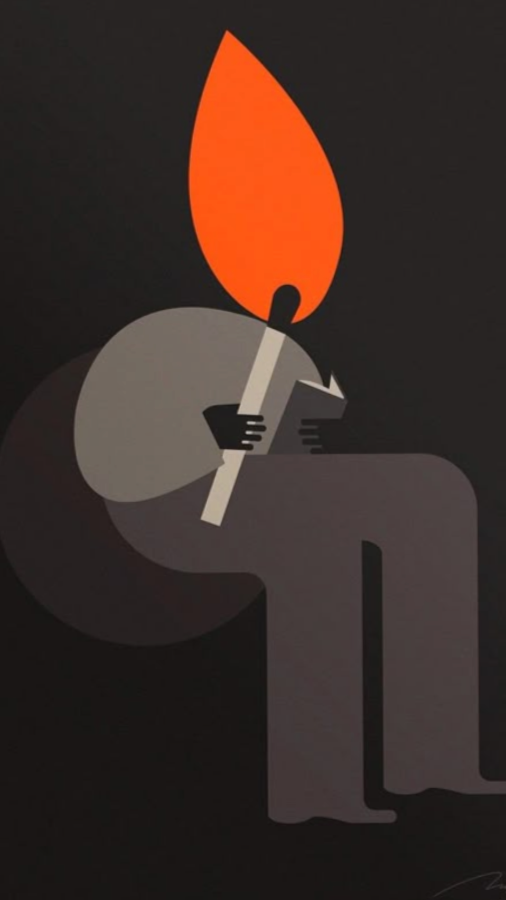

# 火柴照亮持物人物

### G01B

**火柴照亮持物人物**

图源为用户提供的《Gestalt格式塔视觉组织.zip》中的 `Gestalt图片 (1).png`。

- **图中可见。** 橙色焰形、斜向浅色火柴杆和周围暗灰色块相接；手部在杆旁，人物躯干及腿隐入暗底。
- **组织原理。** 橙焰先从暗底中分离，斜杆再把焦点连到手和身体。边缘在低对比处变弱，读者可能先看到火焰，再发现人物。
- **设计实践。** 可用一个饱和色引导至关键部位，再通过可追踪的连接线揭示背景信息。降低亮度或转灰度后检查手与杆的关系是否仍清楚。
- **辅助线索。** [06-连接原则](../../01-规则库/G06-连接律-Connectedness.md) · [16-边界对比与视觉情境](../../04-设计实践经验汇编/16-边界对比与视觉情境.md)

[返回案例库](../README.md)
