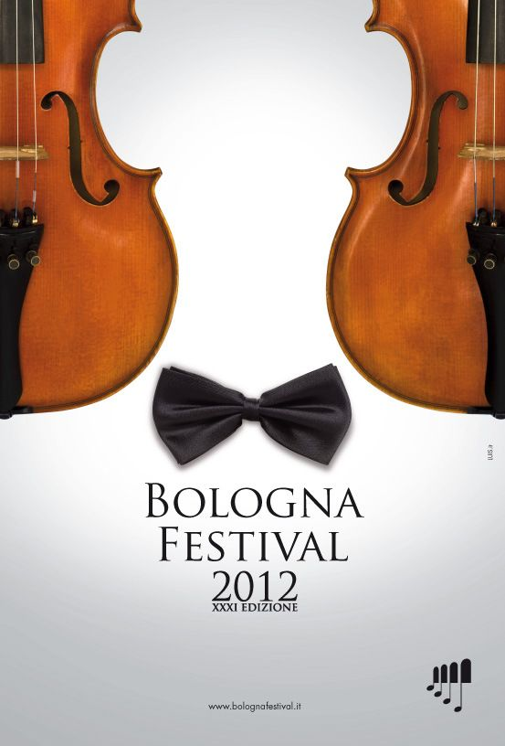

# Bologna Festival 2012 双琴与领结

### G02

**Bologna Festival 2012 双琴与领结**

图源为用户提供的《Gestalt格式塔视觉组织.zip》中的 `Gestalt图片 (2).jpg`。

- **图中可见。** 左右各有一段弦乐器琴身，向内凹的边共同限定中间白地；黑领结在白地与标题之间。
- **组织原理。** 先可辨认两边琴身；注视中间时，轮廓加领结又提示礼服前襟。左右对应稳定了中心位置，领结为第二次识别提供锚点。
- **设计实践。** 在音乐主题页可让两侧对象的内缘交代共同主题。缩小后核对领结仍落在白区中心，标题与白形互不干扰。
- **辅助线索。** [09-对称原则](../../01-规则库/G09-对称律-Symmetry.md) · [05-共同区域原则](../../01-规则库/G05-共同区域律-Common-Region.md)

[返回案例库](../README.md)
