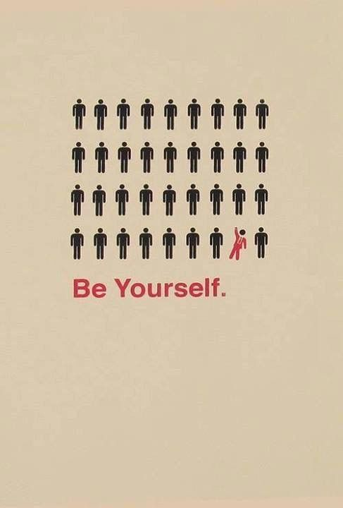

# Be Yourself. 人形阵列

### G03

**Be Yourself. 人形阵列**

图源为用户提供的《Gestalt格式塔视觉组织.zip》中的 `Gestalt图片 (3).jpg`。

- **图中可见。** 黑色人形按近似网格重复，右下附近有一个红色且姿态不同的人形；标语也用红色。
- **组织原理。** 一致造型与排列建立基准组，色彩和姿态的双重差异使一个例外先被发现；红色把例外与标语联系起来。
- **设计实践。** 在重复符号中标记重点，可同时使用色彩与可识别的形态差异。转灰度后仍应能找出目标，图例注明强调含义。
- **辅助线索。** [16-边界对比与视觉情境](../../04-设计实践经验汇编/16-边界对比与视觉情境.md)

[返回案例库](../README.md)
