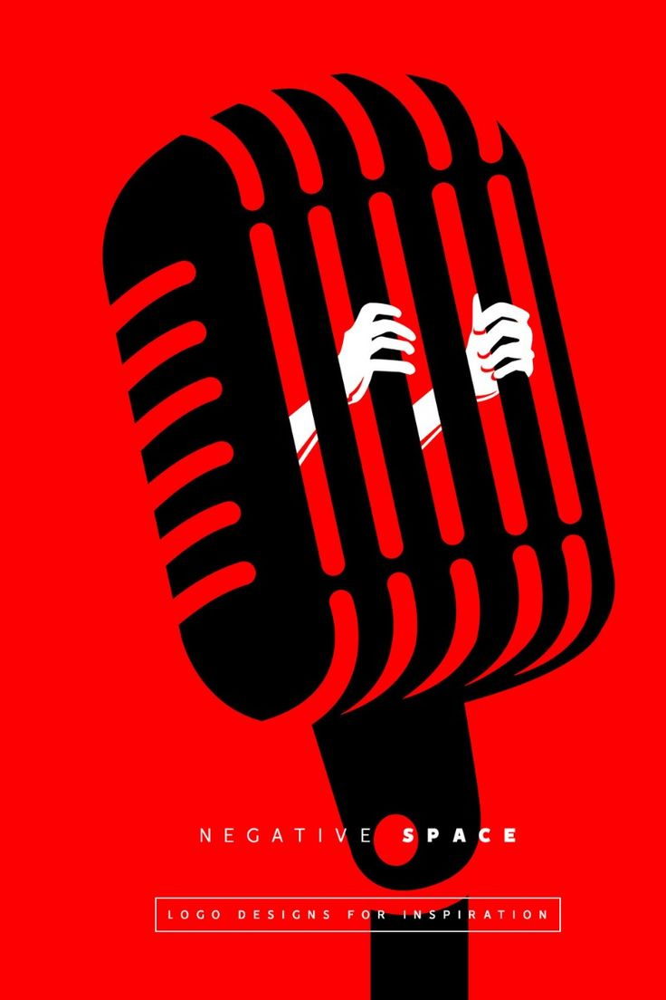

# 麦克风格栅与白手

### G04

**麦克风格栅与白手**

图源为用户提供的《Gestalt格式塔视觉组织.zip》中的 `Gestalt图片 (4).jpg`。

- **图中可见。** 黑色麦克风格栅占据红底中央，白手从几处红色狭缝之间露出。
- **组织原理。** 红色既构成外围背景，也穿入声头内部。白手把本可读为通风槽的间隙转成类似栏杆之间的空间，出现被困的第二层读法。
- **设计实践。** 要让同一空隙承担第二层含义，可用小面积局部线索触发切换。成品尺寸下检查白手清楚且不破坏麦克风轮廓。
- **辅助线索。** [04-闭合原则](../../01-规则库/G08-闭合律-Closure.md)

[返回案例库](../README.md)
