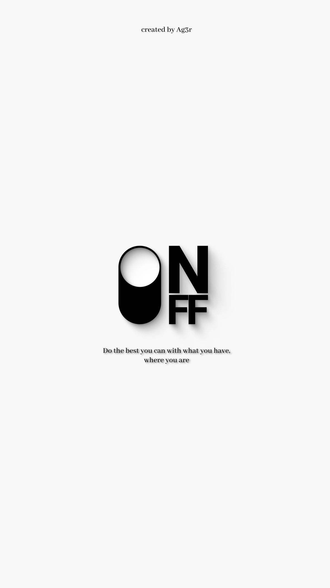

# ON/OFF 开关字形

### G05

**ON/OFF 开关字形**

图源为用户提供的《Gestalt格式塔视觉组织.zip》中的 `Gestalt图片 (5).jpg`。

- **图中可见。** 黑色竖向圆角形与右侧紧邻字母组成小型字标；白圆在上方，ON 与 OFF 共享左侧 O 的形态。
- **组织原理。** 共用的左侧形状把开关控件与两个词压入同一个整体；大面积留白使读者首先定位该共享单元。
- **设计实践。** 设计共享符号时先检查两个词是否都能单独读出。若用于真实交互控件，再用位置和明确标签标出当前状态。
- **辅助线索。** [06-连接原则](../../01-规则库/G06-连接律-Connectedness.md) · [11-图底组织](../../01-规则库/G11-图底关系-Figure–Ground-Organization.md)

[返回案例库](../README.md)
