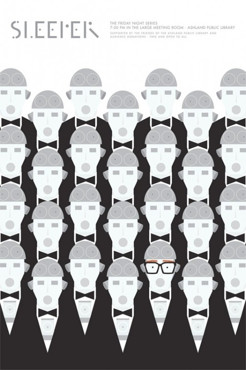

# SLEEPER 交错人物阵列

### G07

**SLEEPER 交错人物阵列**

图源为用户提供的《Gestalt格式塔视觉组织.zip》中的 `Gestalt图片 (7).jpg`。

- **图中可见。** 相近的头部、领结和深色衣身交错排列；靠下的一张脸增加了深色眼镜。
- **组织原理。** 同样的轮廓让多行人物被读成同一阵列。眼镜占面不大，但改变面部内部图案，足以锁定从属同组的个体。
- **设计实践。** 重复图标中可仅修改目标内部的一个特征。用缩略图检查例外是否可见，再核对读者仍把它认作同类。
- **辅助线索。** [01-接近原则](../../01-规则库/G01-接近律-Proximity.md) · [16-边界对比与视觉情境](../../04-设计实践经验汇编/16-边界对比与视觉情境.md)

[返回案例库](../README.md)
