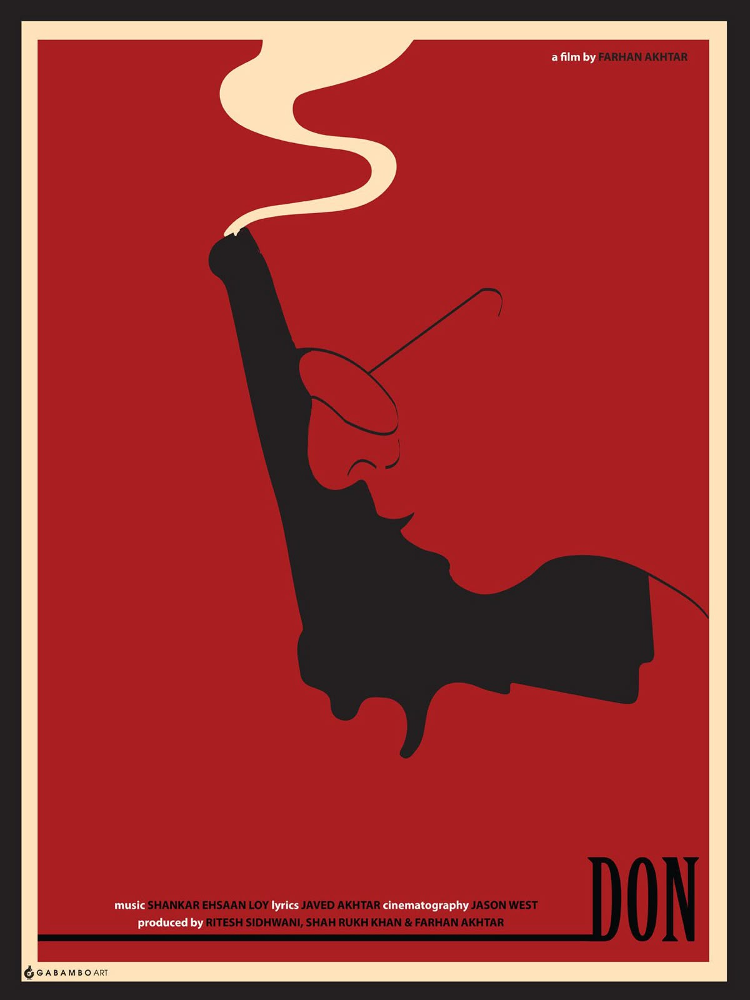

# DON 烟线、手枪与人脸

### G08

**DON 烟线、手枪与人脸**

图源为用户提供的《Gestalt格式塔视觉组织.zip》中的 `Gestalt图片 (8).jpg`。

- **图中可见。** 乳白烟线连到黑色形体的上端；黑色形体的内缘与红底构成人脸侧影，红区另有眼镜线条。
- **组织原理。** 读者可沿烟线定位枪口，再沿红黑交界看到面孔。眼镜使侧影识别更明确，两个主体共用同一段边界。
- **设计实践。** 双重图底构图中，用一条清楚的外轮廓和一处辅助细节分别检验两种读法。不要让标题或数据标签打断转换所需的边界。
- **辅助线索。** [03-良好连续原则](../../01-规则库/G03-良好连续律-Good-Continuation.md)

[返回案例库](../README.md)
