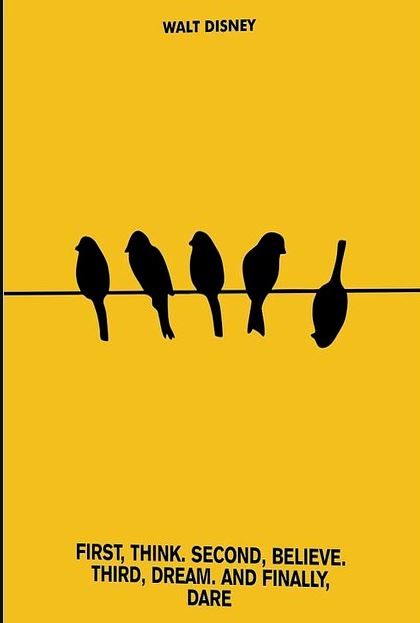

# 共用横线的五只鸟

### G09

**共用横线的五只鸟**

图源为用户提供的《Gestalt格式塔视觉组织.zip》中的 `Gestalt图片 (9).jpg`。

- **图中可见。** 五个黑色剪影与同一水平线相接，右侧个体倒挂，其余大体站在横线上。
- **组织原理。** 横线为所有个体提供持续的共同支撑，姿态改变仍不影响归组。右端倒挂处打破重复，使最后一个物体获得更高注意。
- **设计实践。** 流程图或时间轴可让同类节点接到同一基线，再单独突出例外。公共线须明确表示实际关系，避免与相邻组连错。
- **辅助线索。** [02-相似原则](../../01-规则库/G02-相似律-Similarity.md) · [03-良好连续原则](../../01-规则库/G03-良好连续律-Good-Continuation.md)

[返回案例库](../README.md)
