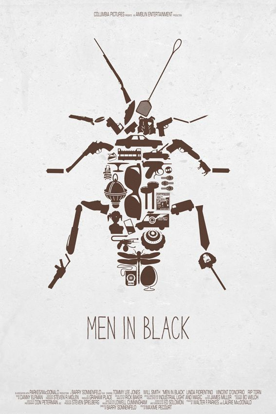

# Men in Black 零件拼成虫形

### G10

**Men in Black 零件拼成虫形**

图源为用户提供的《Gestalt格式塔视觉组织.zip》中的 `Gestalt图片 (10).jpg`。

- **图中可见。** 大量深色小物件在中轴附近密集排列，外侧伸出左右肢体和两根触角，外边界由分散片段暗示。
- **组织原理。** 小物件的间隔在近看时可见，远看时外肢、分节和轴线支持虫形的轮廓补全。大形成立后还能回到局部辨认零件。
- **设计实践。** 先锁定总体轮廓和关键转折，再摆放可辨认的小单元。分别用整图与局部裁切检验整体和细节是否都成立。
- **辅助线索。** [01-接近原则](../../01-规则库/G01-接近律-Proximity.md) · [09-对称原则](../../01-规则库/G09-对称律-Symmetry.md)

[返回案例库](../README.md)
