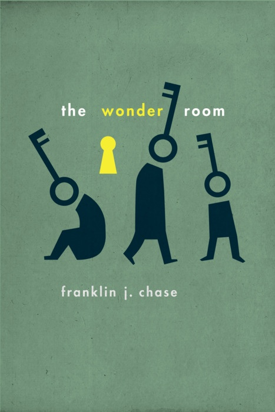

# The Wonder Room 钥匙与人物

### G11

**The Wonder Room 钥匙与人物**

图源为用户提供的《Gestalt格式塔视觉组织.zip》中的 `Gestalt图片 (11).jpg`。

- **图中可见。** 三把深色钥匙的圆环与人物躯干上缘相接，形成钥匙头人物；黄色锁孔独立于三人之间。
- **组织原理。** 接触把原本可独立辨认的钥匙与身体合成复合标记。重复的复合形建立队列，黄色锁孔成为参照焦点。
- **设计实践。** 制定复合图标时让接合处在小尺寸下仍可见。用分离与相接两稿测试人们是否会把两个部件读成同一对象。
- **辅助线索。** [02-相似原则](../../01-规则库/G02-相似律-Similarity.md) · [16-边界对比与视觉情境](../../04-设计实践经验汇编/16-边界对比与视觉情境.md)

[返回案例库](../README.md)
