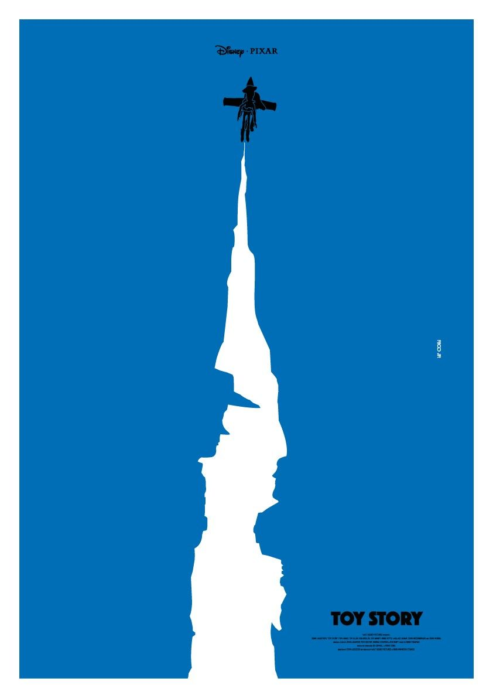

# Toy Story 中央白形与顶部剪影

### G12

**Toy Story 中央白形与顶部剪影**

图源为用户提供的《Gestalt格式塔视觉组织.zip》中的 `Gestalt图片 (12).jpg`。

- **图中可见。** 白色竖形由宽到窄，尖端与顶部深色小剪影对齐；白形边缘有多个明显的侧向转折。
- **组织原理。** 读者可沿连续的窄化方向从下部追到顶端，局部转折则引导读者在蓝白边界寻找侧影。垂直主路径组织了上下信息。
- **设计实践。** 设计纵向阅读路径时，可用连续位移和明确终点维持追踪，再用边缘细节补充第二层。检查转折是否会把视线引到错误模块。
- **辅助线索。** [11-图底组织](../../01-规则库/G11-图底关系-Figure–Ground-Organization.md) · [04-闭合原则](../../01-规则库/G08-闭合律-Closure.md)

[返回案例库](../README.md)
