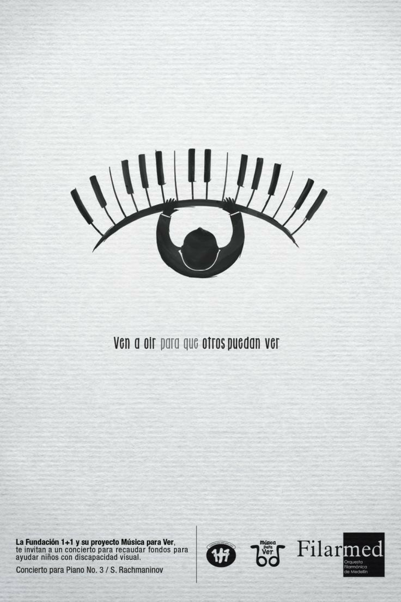

# 琴键弧线构成眼睛

### G13

**琴键弧线构成眼睛**

图源为用户提供的《Gestalt格式塔视觉组织.zip》中的 `Gestalt图片 (13).jpg`。

- **图中可见。** 黑白琴键绕弧排布，弧下只有少量黑色及留白的眼球细节。
- **组织原理。** 弧线相当于眼的上缘，中央深色圆形强化了眼睛读法；保留几个必要部件即可让两种熟悉形态同时可辨。
- **设计实践。** 设计概念图标时列出两种含义各自最必要的形态特征。先隐藏标题，请读者分别指出两层线索。
- **辅助线索。** [03-良好连续原则](../../01-规则库/G03-良好连续律-Good-Continuation.md) · [04-闭合原则](../../01-规则库/G08-闭合律-Closure.md)

[返回案例库](../README.md)
