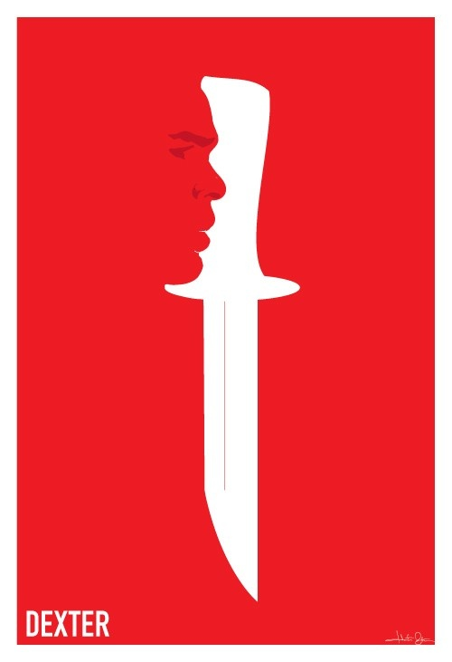

# DEXTER 刀刃与红色侧脸

### G14

**DEXTER 刀刃与红色侧脸**

图源为用户提供的《Gestalt格式塔视觉组织.zip》中的 `Gestalt图片 (14).jpg`。

- **图中可见。** 白色竖形具有刀的护手和刃尖，上端左侧的红白交界形成额头、鼻、嘴与下颌的起伏。
- **组织原理。** 先由完整白块识别刀，再由共享的局部边缘读出人脸；两种解释集中在同一轮廓附近。
- **设计实践。** 双义轮廓应优先确保大形完整，在局部保留容易辨认的转折。测试缩小后鼻、嘴等轮廓能否区别于普通锯齿。
- **辅助线索。** [03-良好连续原则](../../01-规则库/G03-良好连续律-Good-Continuation.md)

[返回案例库](../README.md)
