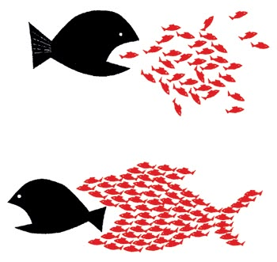

# 散开的鱼群与聚成的大鱼

### G15

**散开的鱼群与聚成的大鱼**

图源为用户提供的《Gestalt格式塔视觉组织.zip》中的 `Gestalt图片 (15).jpg`。

- **图中可见。** 上幅红色小鱼较散；下幅同类小鱼排成明确的大鱼轮廓，黑鱼与群体的位置也发生变化。
- **组织原理。** 密集的重复鱼形在下幅形成可补全的头身尾轮廓。两幅的朝向与位置暗示动作，聚合造型可由静态图直接确认。
- **设计实践。** 用对照图说明群体组织时保持小单元样式一致，只改变排列。若要说明移动的共同命运，可加时间连续的画面验证。
- **辅助线索。** [01-接近原则](../../01-规则库/G01-接近律-Proximity.md) · [02-相似原则](../../01-规则库/G02-相似律-Similarity.md) · [07-共同命运原则](../../01-规则库/G04-共同命运律-Common-Fate.md)

[返回案例库](../README.md)
