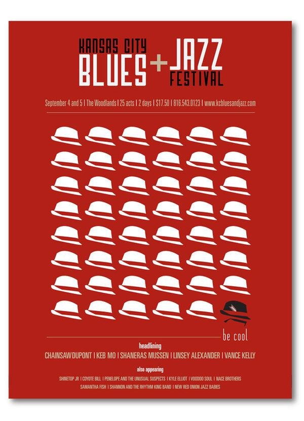

# 爵士节帽子网格中的异色帽

### G16

**爵士节帽子网格中的异色帽**

图源为用户提供的《Gestalt格式塔视觉组织.zip》中的 `Gestalt图片 (16).jpg`。

- **图中可见。** 浅色礼帽以相近尺寸、倾斜角度和网格间距排列，右下方出现深色帽形。
- **组织原理。** 帽子的外形与规律位置先建立同类组。深色帽仍保持类别特征，却通过明暗差成为网格中的例外。
- **设计实践。** 在整齐排列的类别标记中，若用色彩标记异常，应保持轮廓一致并补文字说明，使异常仍能归回同组。
- **辅助线索。** [16-边界对比与视觉情境](../../04-设计实践经验汇编/16-边界对比与视觉情境.md)

[返回案例库](../README.md)
