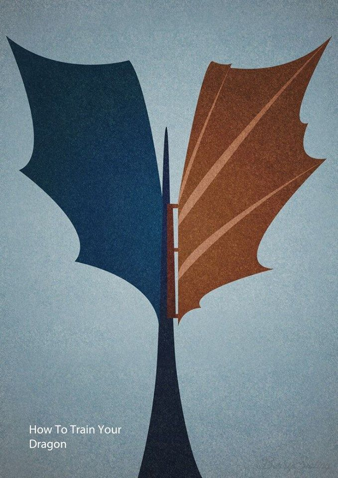

# How To Train Your Dragon 两侧翼形

### G17

**How To Train Your Dragon 两侧翼形**

图源为用户提供的《Gestalt格式塔视觉组织.zip》中的 `Gestalt图片 (17).jpg`。

- **图中可见。** 蓝色和棕色翼形各据中轴一侧，外缘大体呼应；棕翼有内部骨条并经小横段连接中轴。
- **组织原理。** 围绕共同轴线的近似对称让两翼被读为一个整体。差异集中在颜色和结构内线，使两侧可比较，同时保留连接关系。
- **设计实践。** 对照构图可共用轴线并保留真实差异。若用于数据比较，让长度或面积按独立数值计算，别用镜像复制数据。
- **辅助线索。** [06-连接原则](../../01-规则库/G06-连接律-Connectedness.md) · [11-图底组织](../../01-规则库/G11-图底关系-Figure–Ground-Organization.md)

[返回案例库](../README.md)
