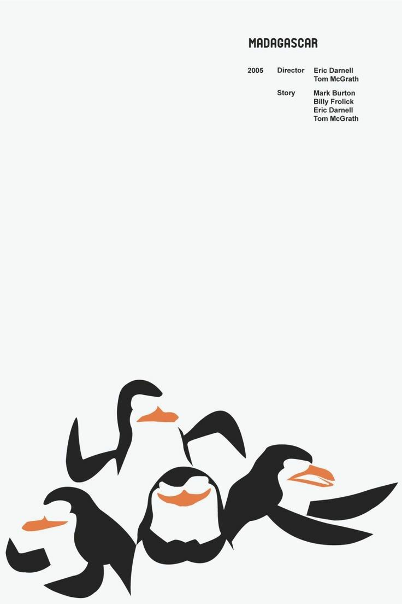

# Madagascar 企鹅组像

### G18

**Madagascar 企鹅组像**

图源为用户提供的《Gestalt格式塔视觉组织.zip》中的 `Gestalt图片 (18).jpg`。

- **图中可见。** 白腹与大片白底相接，黑色头背、翅膀和橙色喙分散在画面底部。
- **组织原理。** 局部黑边与喙为每个身体提供位置线索，读者补全缺失的白色轮廓，近距离的若干个体同时被看成一个角色组。
- **设计实践。** 浅色对象与底色相近时可保留关键关节和方向线索。测试四个头部与身体是否能一一对应，避免轮廓并错。
- **辅助线索。** [01-接近原则](../../01-规则库/G01-接近律-Proximity.md) · [11-图底组织](../../01-规则库/G11-图底关系-Figure–Ground-Organization.md)

[返回案例库](../README.md)
