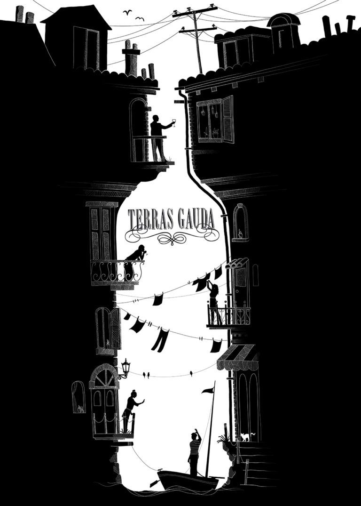

# Terras Gauda 街巷留白中的酒瓶

### G19

**Terras Gauda 街巷留白中的酒瓶**

图源为用户提供的《Gestalt格式塔视觉组织.zip》中的 `Gestalt图片 (19).jpg`。

- **图中可见。** 画面两侧为深色建筑，中部亮区的宽窄变化构成瓶口、瓶肩和瓶身，街景细节穿过亮区。
- **组织原理。** 建筑内缘共享亮区边界，先能读作街巷，也能重组为直立的酒瓶。瓶身的文字增强后者，街景仍提供场景语境。
- **设计实践。** 在留白形中放文字时避开瓶肩等识别转折。测试时先遮住品牌文字，判断轮廓能否独立被识别。
- **辅助线索。** [04-闭合原则](../../01-规则库/G08-闭合律-Closure.md)

[返回案例库](../README.md)
