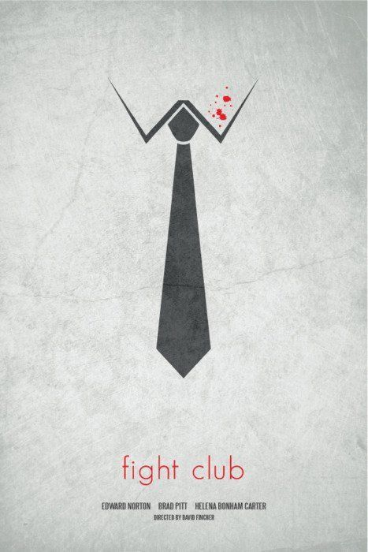

# Fight Club 衣领、领带与红点

### G20

**Fight Club 衣领、领带与红点**

图源为用户提供的《Gestalt格式塔视觉组织.zip》中的 `Gestalt图片 (20).jpg`。

- **图中可见。** 黑色细折线提示衬衣领口，居中黑色领带和近领口的少量红点集中在浅灰背景上。
- **组织原理。** 领口与领带的位置关系足以提示一套穿着，无需画满身体。小面积红点与规整的居中结构形成破坏性差异。
- **设计实践。** 压缩图形细节时先保留对象间的相互位置。若红点承担警示含义，应让其和背景能可靠区分，并以标签解释。
- **辅助线索。** [09-对称原则](../../01-规则库/G09-对称律-Symmetry.md) · [16-边界对比与视觉情境](../../04-设计实践经验汇编/16-边界对比与视觉情境.md)

[返回案例库](../README.md)
