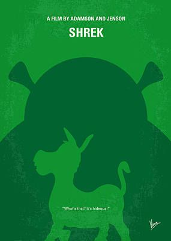

# SHREK 大头像和浅绿驴形

### G21

**SHREK 大头像和浅绿驴形**

图源为用户提供的《Gestalt格式塔视觉组织.zip》中的 `Gestalt图片 (21).jpg`。

- **图中可见。** 深绿头像随两侧耳朵形成大轮廓，浅绿驴形落入其下部，外围与内部绿调分层。
- **组织原理。** 明度差使读者先认出大头像，然后在深色区域内辨出另一角色。内嵌轮廓提供角色关联，面积层级使两形有主次。
- **设计实践。** 对有主次的图形采用两层可辨对比。转灰度与缩小后都应能分开轮廓，辅助文字避免贴到小形边缘。
- **辅助线索。** [05-共同区域原则](../../01-规则库/G05-共同区域律-Common-Region.md) · [16-边界对比与视觉情境](../../04-设计实践经验汇编/16-边界对比与视觉情境.md)

[返回案例库](../README.md)
