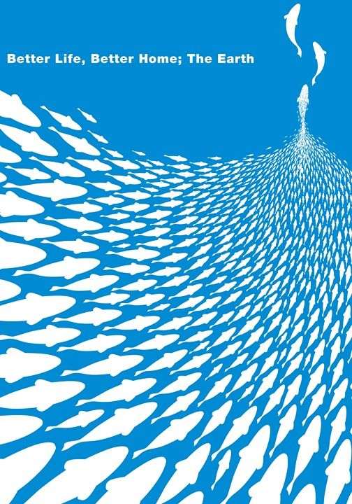

# 白色鱼形向远处汇聚

### G22

**白色鱼形向远处汇聚**

图源为用户提供的《Gestalt格式塔视觉组织.zip》中的 `Gestalt图片 (22).jpg`。

- **图中可见。** 蓝底上的白色鱼形随画面走向逐渐变小、变密，形成弧向排列并向上方收束。
- **组织原理。** 相邻鱼形的排布、朝向与大小变化支持多条平滑轨迹，使视线顺着群体走向收束点。动势来自静态布置。
- **设计实践。** 在路径图中保持列间方向逐步过渡，用清楚的终点说明路径作用。若渐变大小没有统计含义，在数据图里避免让读者把它当成数量差。
- **辅助线索。** [02-相似原则](../../01-规则库/G02-相似律-Similarity.md) · [07-共同命运原则](../../01-规则库/G04-共同命运律-Common-Fate.md) · [16-边界对比与视觉情境](../../04-设计实践经验汇编/16-边界对比与视觉情境.md)

[返回案例库](../README.md)
