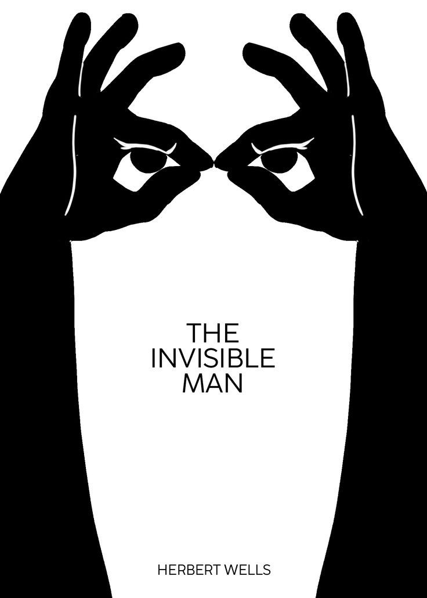

# The Invisible Man 双手与隐形面孔

### G23

**The Invisible Man 双手与隐形面孔**

图源为用户提供的《Gestalt格式塔视觉组织.zip》中的 `Gestalt图片 (23).jpg`。

- **图中可见。** 两只深色手围绕中轴大体镜像，指环状空隙内有眼状细节；白色中部不画完整脸。
- **组织原理。** 对称稳定了双手与双眼的配对，中央空白因此可读作被暗示的脸，读者在手形和脸形之间切换。
- **设计实践。** 需要成对对照时，共用轴能帮助定位相应项。测试时独立移动一侧，观察何时破坏整体感，保留有含义的不对称。
- **辅助线索。** [11-图底组织](../../01-规则库/G11-图底关系-Figure–Ground-Organization.md) · [04-闭合原则](../../01-规则库/G08-闭合律-Closure.md)

[返回案例库](../README.md)
