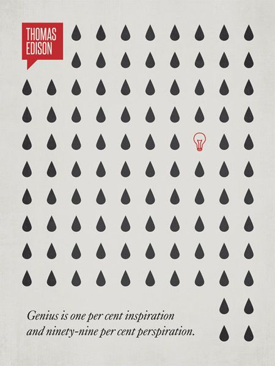

# Thomas Edison 水滴阵列中的灯泡

### G24

**Thomas Edison 水滴阵列中的灯泡**

图源为用户提供的《Gestalt格式塔视觉组织.zip》中的 `Gestalt图片 (24).jpg`。

- **图中可见。** 深色水滴以一致图样和间距重复，一个小灯泡以红色轮廓置于阵列内部；下方有百分比文案。
- **组织原理。** 灯泡由形和色同时偏离水滴组，但仍占据类似网格位置。多数与例外的视觉对照服务文案；图符实际计数和百分比口径需另核。
- **设计实践。** 用象形阵列表示比例时注明每个符号代表的量，逐行核对数量。若是修辞性插图，用文字交代含义，避免暗示比例能由图符精确读出。
- **辅助线索。** [16-边界对比与视觉情境](../../04-设计实践经验汇编/16-边界对比与视觉情境.md)

[返回案例库](../README.md)
