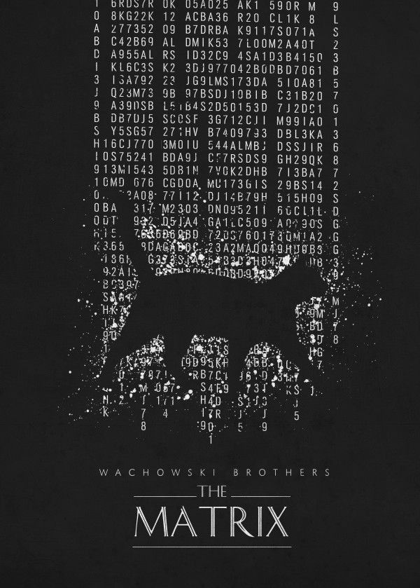

# The Matrix 字符雨中的黑色剪影

### G25

**The Matrix 字符雨中的黑色剪影**

图源为用户提供的《Gestalt格式塔视觉组织.zip》中的 `Gestalt图片 (25).jpg`。

- **图中可见。** 浅色字符在暗底上形成密集纵列，中央有一块由字符减少形成的深色剪影，边缘伴有散点。
- **组织原理。** 字符群建立局部背景，内部缺口被组织为主体。密度反差使人物式剪影可见，轮廓可由相邻字符终止的位置推断。
- **设计实践。** 若用缺口呈现主体，先检查外围纹理密度足以定义边缘。对照有无缺口的版本，确认读者能说出主体位置。
- **辅助线索。** [02-相似原则](../../01-规则库/G02-相似律-Similarity.md) · [04-闭合原则](../../01-规则库/G08-闭合律-Closure.md)

[返回案例库](../README.md)
