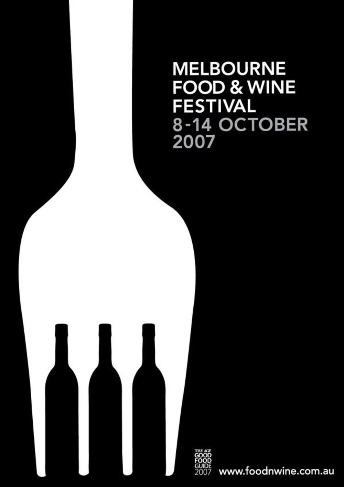

# Melbourne Food & Wine Festival 餐叉与酒瓶

### G27

**Melbourne Food & Wine Festival 餐叉与酒瓶**

图源为用户提供的《Gestalt格式塔视觉组织.zip》中的 `Gestalt图片 (27).jpg`。

- **图中可见。** 白色大形似餐叉，叉端组内的三个深色酒瓶状间隙近似同形，外围为黑底。
- **组织原理。** 白色外形限定了叉端的共同范围，三个插入其间的深色形因此形成一组。黑白反转时又能各自读作酒瓶，连接食物与酒主题。
- **设计实践。** 在一个容器中组织多项时，用共同边界维持所属关系。若留白兼作第二形，需检查底部开口是否使容器归属含混。
- **辅助线索。** [11-图底组织](../../01-规则库/G11-图底关系-Figure–Ground-Organization.md) · [02-相似原则](../../01-规则库/G02-相似律-Similarity.md)

[返回案例库](../README.md)
