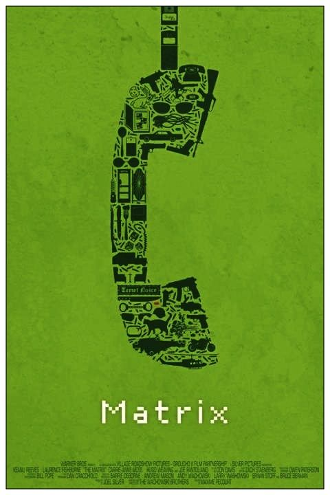

# Matrix 零件组成电话听筒

### G28

**Matrix 零件组成电话听筒**

图源为用户提供的《Gestalt格式塔视觉组织.zip》中的 `Gestalt图片 (28).jpg`。

- **图中可见。** 深色小零件密集摆放成弯曲的电话听筒，上端接向画面边缘，绿色背景定义听筒外部。
- **组织原理。** 内部间距小于与外界空白的分隔，多个不同零件先聚成一个大块；总体形态靠两端鼓起与中段弯曲被识别。
- **设计实践。** 用异质图标拼成大形时，先控制内外间距，再保留少量连续边缘。缩小验证大形，放大验证单元不会被错当成重复计数图符。
- **辅助线索。** [04-闭合原则](../../01-规则库/G08-闭合律-Closure.md) · [11-图底组织](../../01-规则库/G11-图底关系-Figure–Ground-Organization.md)

[返回案例库](../README.md)
