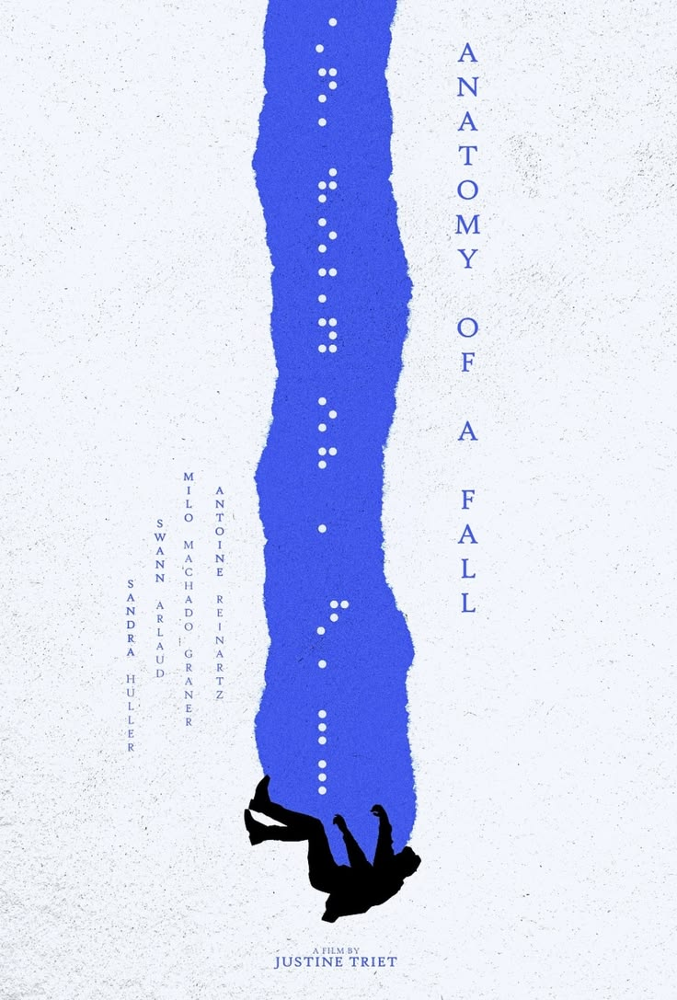

# Anatomy of a Fall 蓝带内的点列

### G29

**Anatomy of a Fall 蓝带内的点列**

图源为用户提供的《Gestalt格式塔视觉组织.zip》中的 `Gestalt图片 (29).jpg`。

- **图中可见。** 竖向蓝色窄带圈定若干白点，坠落剪影位于带尾，标题沿带外侧竖排。
- **组织原理。** 蓝带把散点组织为同一列内的内容，竖向连续性把读者带到末端。标题位置与点带相邻，仍可通过带边界分清内外。
- **设计实践。** 在同页放置顺序列和外侧注释时，可用连续浅底限定列的数据区。检查读者是否会把栏外注释误认为列内记录。
- **辅助线索。** [03-良好连续原则](../../01-规则库/G03-良好连续律-Good-Continuation.md) · [10-平行原则](../../01-规则库/G10-平行律-Parallelism.md)

[返回案例库](../README.md)
