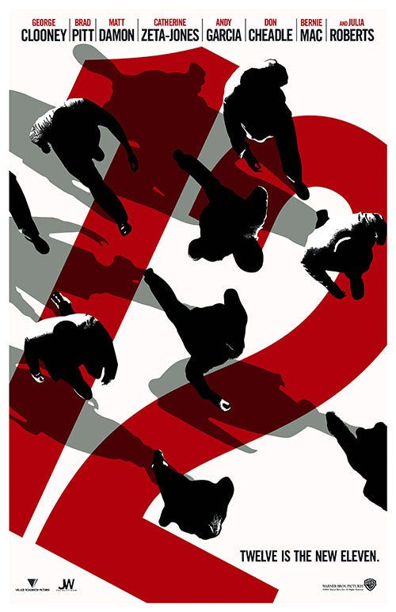

# 被人物剪影打断的红色 12

### G30

**被人物剪影打断的红色 12**

图源为用户提供的《Gestalt格式塔视觉组织.zip》中的 `Gestalt图片 (30).jpg`。

- **图中可见。** 大号红色数字与黑色人物剪影及灰色投影交叠，数字部分边缘被遮住。
- **组织原理。** 可见的笔画段仍提供熟悉数字的轮廓，读者可跨越遮挡补全。红色数字承担背景层次，前景人物也能被识别。
- **设计实践。** 若把大字号作为叙事背景，先保留笔画的关键转折。实际数据值应完整标出，验证遮挡不会导致 12 与其他数字混读。
- **辅助线索。** [03-良好连续原则](../../01-规则库/G03-良好连续律-Good-Continuation.md) · [11-图底组织](../../01-规则库/G11-图底关系-Figure–Ground-Organization.md)

[返回案例库](../README.md)
