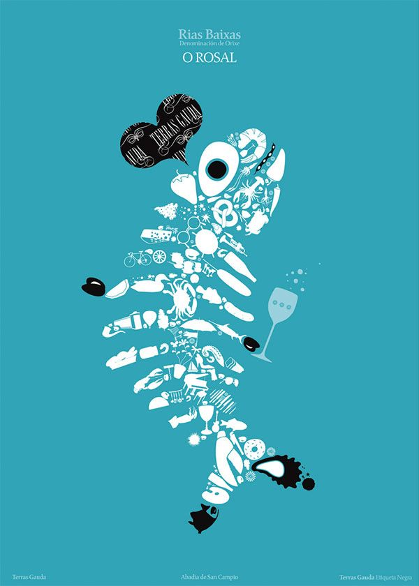

# O Rosal 小图标拼成大形

### G31

**O Rosal 小图标拼成大形**

图源为用户提供的《Gestalt格式塔视觉组织.zip》中的 `Gestalt图片 (31).jpg`。

- **图中可见。** 白色小图标在青蓝底上紧密聚集，上部有圆眼形，周围有少量脱离主体的黑白部件。
- **组织原理。** 组内相邻小形的距离形成连贯区，外围空白让它被读成具有头部与肢体的大形。少量离群部件位置较远，仍可作为局部细节。
- **设计实践。** 用一组图标构成主形时，先安排组内距离和外缘缺口。把局部图标打散作对照，验证大形究竟来自间距还是单个显著部件。
- **辅助线索。** [04-闭合原则](../../01-规则库/G08-闭合律-Closure.md) · [11-图底组织](../../01-规则库/G11-图底关系-Figure–Ground-Organization.md)

[返回案例库](../README.md)
