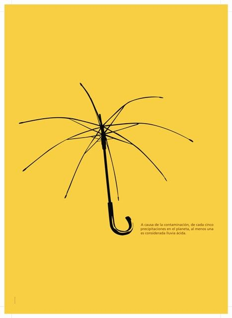

# 伞骨、中心节点与弯柄

### G32

**伞骨、中心节点与弯柄**

图源为用户提供的《Gestalt格式塔视觉组织.zip》中的 `Gestalt图片 (32).jpg`。

- **图中可见。** 多条深色细线在黄色背景中央相接，再沿竖向主杆接到弯柄；伞面边缘未画满。
- **组织原理。** 交汇点、主杆和弯柄把细线组织成一个伞架，读者沿辐条能回到同一节点。保留骨架足以提示整体对象。
- **设计实践。** 连接图可用清晰的节点和线端维持归属。去掉填充面后仍应让读者准确指出哪些线真的相接。
- **辅助线索。** [03-良好连续原则](../../01-规则库/G03-良好连续律-Good-Continuation.md) · [12-简洁与良好形态原则](../../01-规则库/G12-良好形态原则-Prägnanz.md)

[返回案例库](../README.md)
