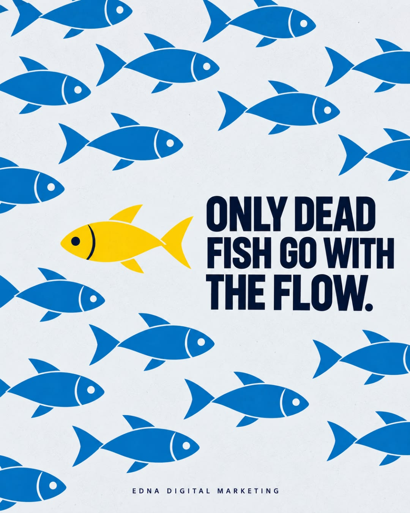

# 反向游动的黄色鱼

### G33

**反向游动的黄色鱼**

图源为用户提供的《Gestalt格式塔视觉组织.zip》中的 `Gestalt图片 (33).jpg`。

- **图中可见。** 蓝鱼大多同向，黄色鱼在中部朝反方向，旁边配有关于随流的文字。
- **组织原理。** 统一的鱼形和朝向建立参照，反向且异色的鱼被快速挑出。静态图能确认朝向，画面语义提示移动。
- **设计实践。** 可用相反朝向和补充色标记偏离。如果要验证共同命运，另用动态版本，让不同组沿各自方向持续移动。
- **辅助线索。** [02-相似原则](../../01-规则库/G02-相似律-Similarity.md) · [07-共同命运原则](../../01-规则库/G04-共同命运律-Common-Fate.md)

[返回案例库](../README.md)
