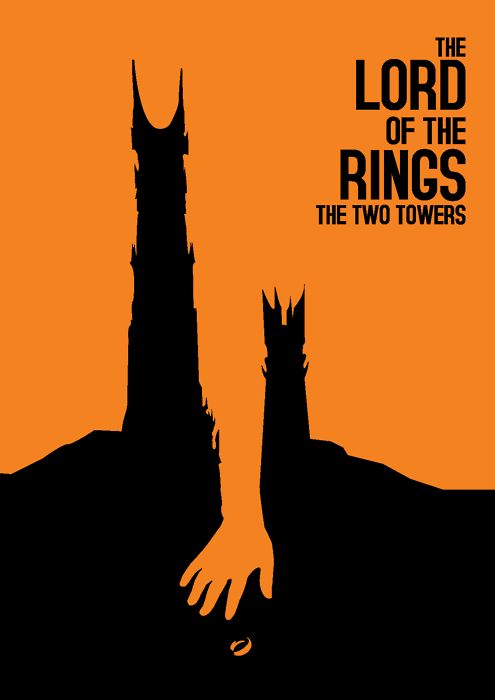

# The Two Towers 双塔之间的手

### G34

**The Two Towers 双塔之间的手**

图源为用户提供的《Gestalt格式塔视觉组织.zip》中的 `Gestalt图片 (34).jpg`。

- **图中可见。** 两个不等高的深色塔形由下方暗色地面连起，塔间的橙色留白向下延伸，末端有明显手指轮廓。
- **组织原理。** 塔形先作为黑色主体成立，连续的橙色带再被重组为伸下的手，双塔内缘和手臂共用边界。
- **设计实践。** 在标题构图里用负形提示第二个叙事对象时，保留识别手势的分叉。测试读者能否先后定位两座塔和那只手。
- **辅助线索。** [04-闭合原则](../../01-规则库/G08-闭合律-Closure.md) · [03-良好连续原则](../../01-规则库/G03-良好连续律-Good-Continuation.md)

[返回案例库](../README.md)
